<h1 align="center">Moworks Studio</h1>

<p align="center"><b>English</b> · <a href="README.vi.md">Tiếng Việt</a></p>

<p align="center"><b>A desktop studio for motion films: Claude directs, Moworks Studio builds and checks every frame, you approve each step.</b></p>

<p align="center">
  
  
  
  
  
</p>

<p align="center">
  <a href="#quick-start">Quick start</a> ·
  <a href="#how-it-works">How it works</a> ·
  <a href="#how-a-film-is-made">How a film is made</a> ·
  <a href="#film-styles">Film styles</a> ·
  <a href="#walkthrough">Walkthrough</a> ·
  <a href="#troubleshooting">Troubleshooting</a> ·
  <a href="CHANGELOG.md">Changelog</a> ·
  <a href="KNOWN-ISSUES.md">Known issues</a> ·
  <a href="THIRD-PARTY.md">Third-party</a>
</p>

<p align="center">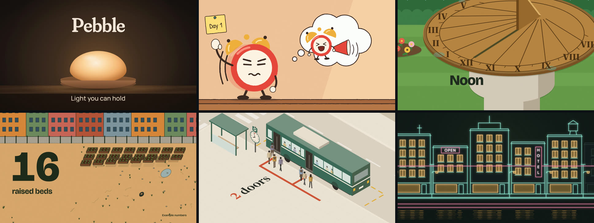</p>
<p align="center"><sub>Demo films made in the app. Top: a lamp launch (Launch · style by HeyGen) · an alarm clock (Character · style by HeyGen) · a sundial (Explainer · style by HeyGen).<br>Bottom: a garden in numbers (Data · style by HeyGen) · a bus stop (Isometric Picture Book · style by Lemomo) · a neon city (Music video · style by HeyGen). More in <a href="#made-in-the-app">Made in the app</a>.</sub></p>

Moworks Studio is a desktop application for making motion-graphic films with Claude. You write a brief and add your material (artwork,
PSD, deck, pictures, music, a voice-over script) and choose one of 126 film styles. Claude plans the film, draws a storyboard for you to
approve and writes a Motion Plan in numbers; then the app builds the film shot by shot in code, reviews and scores it, mixes music and
sound effects, runs technical checks and renders an MP4. Films in most styles can also be exported to After Effects as editable layers.

Every step waits for you where it matters: you approve the storyboard and the Motion Plan, follow the build live in the Editor, and ask
for changes in plain words. The app runs on your computer and drives Claude Code under your own Claude account; your projects, keys and
client material stay on the machine.

> **Status: private preview.** This repository is shared with invited users only. Please do not redistribute it.

## How it works

<p align="center">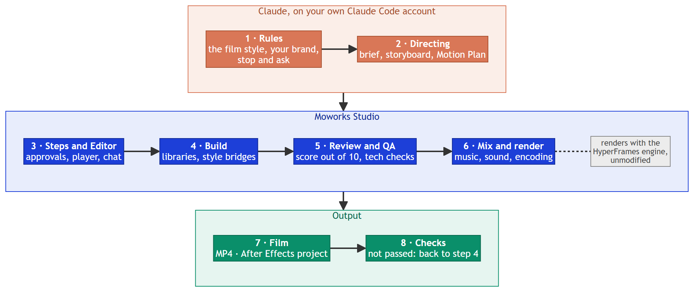</p>

Colours: orange = Claude · blue = Moworks Studio · green = output · grey = the open-source render engine.

Claude directs: it follows the film style's rules and your brand, and stops to ask when something conflicts. Moworks Studio does the
rest: it runs the steps and their approvals, builds each shot with its motion libraries and style bridges, reviews and scores the film,
mixes the sound and renders. Rendering uses the open-source HyperFrames engine as shipped.

## Why make films in code

- **Deterministic:** every frame is a function of time. The same project renders the same frames every time.
- **Local edits:** change one shot, one line of text or one beat without touching the rest.
- **Edits in words:** "make the transition faster", "change the music", "bring the title in on the downbeat" are changes Claude makes in
  minutes, inside the same project.
- **Reviewable at every step:** the brief, storyboard and Motion Plan are files you read and approve before any motion is built.

## How a film is made

Every film style follows the same pipeline. Each step leaves a file in the project, and nothing moves on until its step is done or you
skip it.

<p align="center">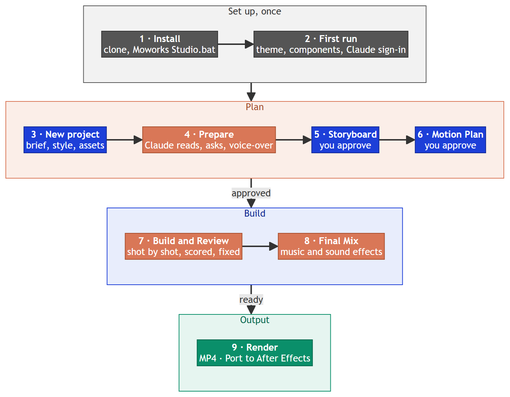</p>

Colours: grey = set-up · orange = Claude and the app · blue = you write, choose or approve · green = output.

| Step | What happens | You |
|---|---|---|
| **Brief** | New project: title, film style, Brand Kit, characters, format (size, frame rate, length), Claude model and effort, the brief and your assets | write and choose |
| **Prepare** | Claude reads the brief and your assets and writes `BRIEF.md`. When the brief and the style disagree (a silent-film style with a voice-over, 4:3 against 4:5…), it stops and asks, with options and a recommendation | answer |
| **Voice-over** *(optional)* | ElevenLabs (or Fish Audio) speaks the script; Whisper times every word so shots land on the words (an optional download, offered the first time) | pick a voice |
| **Storyboard** | One storyboard option drawn as a board, shot by shot, with the reason for each shot (another option on request) | approve or comment |
| **Motion Plan** | Every shot's motion in numbers: timings, distances, easings, sound cues. The approval dialog shows the estimated build time and Claude usage | approve and build |
| **Build** | Claude builds the film in code, shot by shot; every shot is linted and checked as it lands | watch |
| **Review** | Claude watches its own film, scores it out of 10 and fixes what it finds, in rounds | read the score |
| **Final Mix** | Music (three free Mixkit tracks to choose from, or your own) and sound effects placed on the picture, mixed to −16 LUFS | choose |
| **Tech checks** | Contrast, text overlap, still frames, loudness and file checks, in plain words | read |
| **Render** | MP4 (Standard for web and social, or High), plus a Smooth preview copy for playback in the Editor | render |
| **After Effects** | **Port to After Effects** builds an AE project with real text and shape layers where the style allows it | port |

The **Editor** plays the film frame by frame as it will render, with the shots and the pipeline on the left, the timeline below the picture
and Claude in a chat column on the right. Click an element in the film to make it Claude's target, or edit its words by hand.

<p align="center">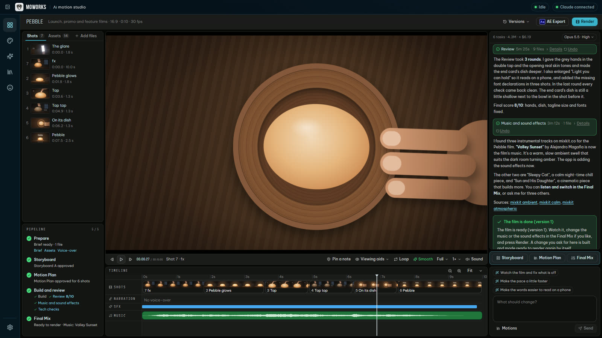<br><sub>The Editor (The Desk): shots and pipeline on the left, the film in the player, the timeline, and Claude's account of each step on the right</sub></p>

### After Effects badges

Each film style carries a badge measured on a demo film of that style:

| Badge | What After Effects gets |
|---|---|
| **AE editable** | Text and shapes as layers you can edit |
| **AE partly editable** | Some parts come in as layers, others as video |
| **AE video only** | The film as one video layer |

### Two themes

The app has two complete themes with the same features; the first start asks which one to use, and Settings › General › Appearance changes it.

- **The Desk** (default): a dark, quiet workspace with a left navigation rail.
- **The Studio**: a light-table workshop: paper, pegboard, handwritten labels, storyboards pinned to a board.

<table>
<tr>
<td width="50%" valign="top">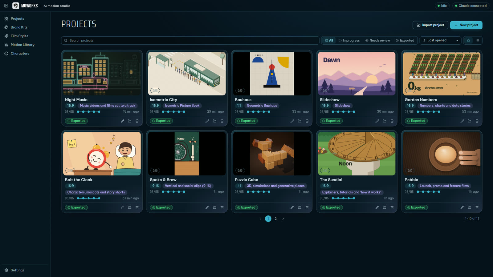<br><sub>The Desk · Projects</sub></td>
<td width="50%" valign="top">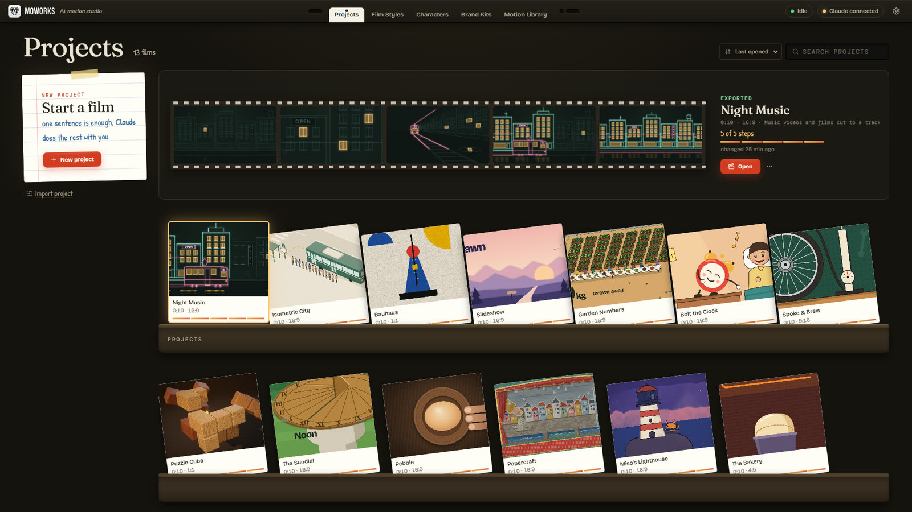<br><sub>The Studio · Projects</sub></td>
</tr>
<tr>
<td width="50%" valign="top">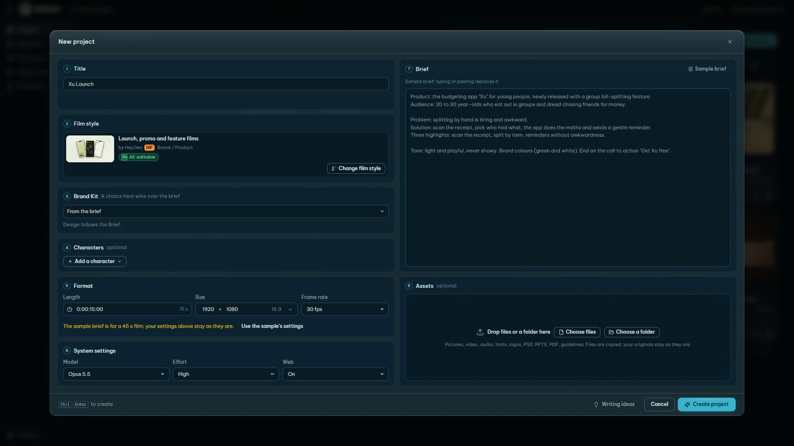<br><sub>The Desk · New project</sub></td>
<td width="50%" valign="top">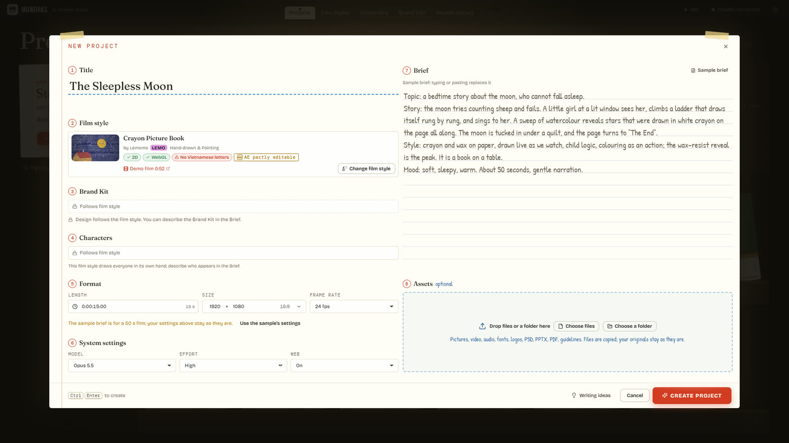<br><sub>The Studio · New project</sub></td>
</tr>
<tr>
<td width="50%" valign="top">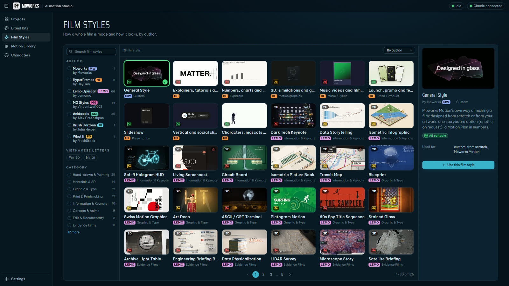<br><sub>The Desk · Film Styles, 126 styles by author</sub></td>
<td width="50%" valign="top">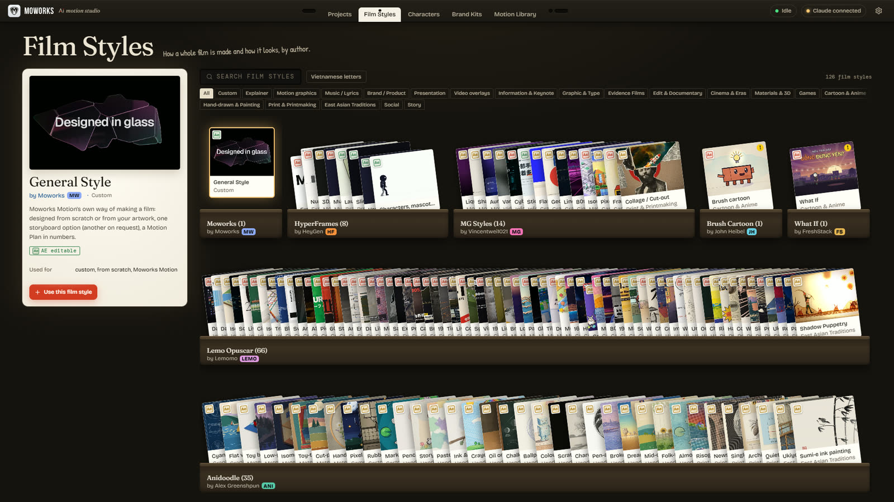<br><sub>The Studio · Film Styles as crates by author</sub></td>
</tr>
</table>

## Film styles

A film style sets the whole look and the rules Claude follows. The Film Styles gallery groups them by author; each card names its author,
licence and the exact source commit. Third-party style files are used as their authors ship them, pinned at one commit.

| Set | Author | Styles | Licence | Source |
|---|---|---|---|---|
| **General Style** | Moworks | 1 | the app's own rules | rewritten for the app from the Moworks Motion kit's process |
| **HyperFrames** | HeyGen | 8: Slideshow and the seven film types of HyperFrames' skill (Explainer, Launch, Music video, Data, Vertical, 3D, Character) | Apache-2.0 | [heygen-com/hyperframes @ `4719543`](https://github.com/heygen-com/hyperframes/tree/4719543e972548a261b8354f0a8dada479ae5d93/skills) (v0.8.214) |
| **Lemo-Opuscar** | Lemomo (LemoLab) | 66 code-built film styles (cinema eras, documentary, editorial, data…; Memphis Diorama contributed by EianLu) | MIT; demo stills CC BY 4.0 | [lemomo-ai/lemo-opuscar @ `ea34ff9`](https://github.com/lemomo-ai/lemo-opuscar/tree/ea34ff9546f675f9fd65a3c84e869a1da7471ad7) |
| **mg-styles-15** | Vincentwei1021 | 14 motion-design styles (the Blender-based 3D style is not offered) | MIT | [Vincentwei1021/mg-styles-15 @ `49052d8`](https://github.com/Vincentwei1021/mg-styles-15/tree/49052d80bfaf9fa8412cc9710530e5e95a3b8d8c) |
| **Anidoodle** | Alex Greenshpun (10x Company) | 35 hand-drawn media (32 media + 3 house styles) | Apache-2.0 with NOTICE | [alexgreensh/anidoodle @ `f746cbd`](https://github.com/alexgreensh/anidoodle/tree/f746cbd8a7032463bd0bc88ee8ff852599193b8c) (v0.9.6) |
| **Brush cartoon** | John Heibel | 1: a brush-drawn cartoon acted by the project's own characters | MIT (p5.js LGPL-2.1, p5.brush MIT) | [JohnHeibel/ClaudeAnimationBase @ `0ac8bf2`](https://github.com/JohnHeibel/ClaudeAnimationBase/tree/0ac8bf2b31942376cb6b8c4074715595d512acd2) |
| **What If** | FreshStack (kelano86) | 1: short "What if…" episodes | MIT | [kelano86/what-if-animation @ `3725a22`](https://github.com/kelano86/what-if-animation/tree/3725a22d2d101320cae5b7d761af8d75120c4987) |

Every style also follows two app-wide rule packs: **films stay alive** (no frame holds still for more than two seconds) and **stop and
ask** (a conflict or a missing asset is a question for you, never a silent guess).

### Made in the app

Stills from demo films made with Moworks Studio, each in a different style. The stories are original; the style and its author are
named under each still.

<table>
<tr>
<td width="33%" valign="top">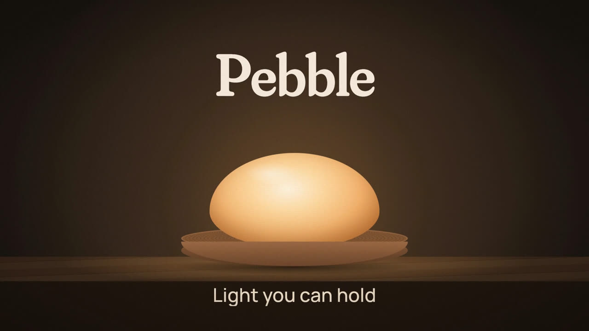<br><sub><b>Pebble, a lamp launch</b> · Launch · style by HeyGen</sub></td>
<td width="33%" valign="top">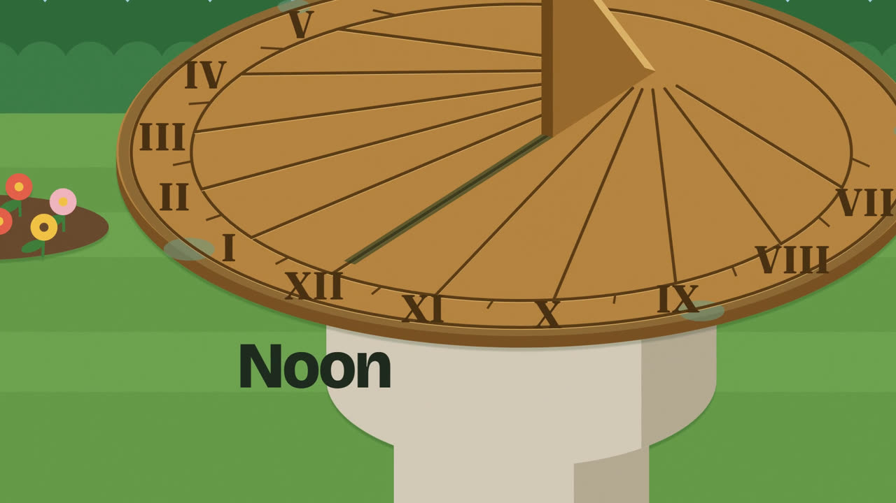<br><sub><b>How a sundial works</b> · Explainer · style by HeyGen</sub></td>
<td width="33%" valign="top">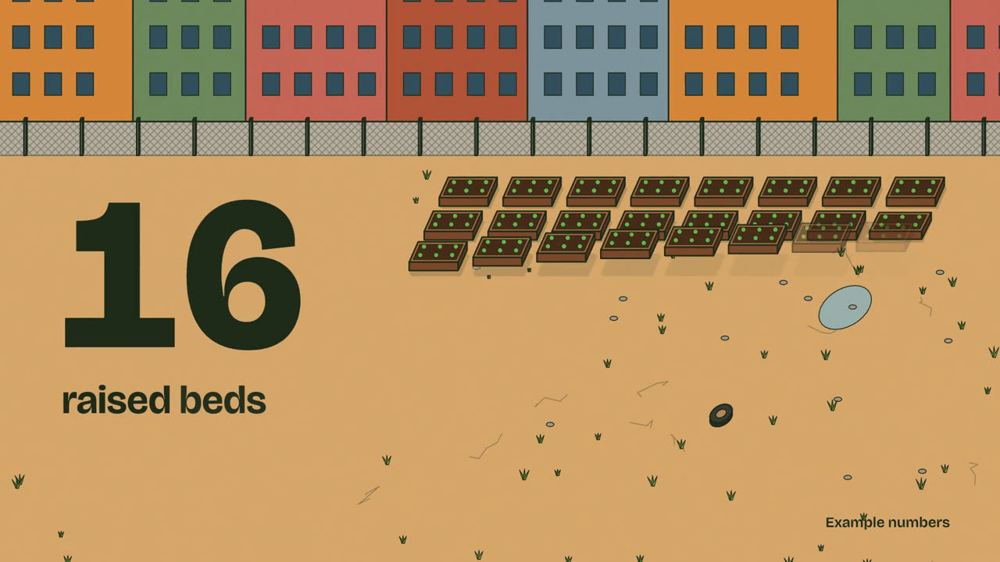<br><sub><b>A community garden in numbers</b> · Data · style by HeyGen</sub></td>
</tr>
<tr>
<td width="33%" valign="top">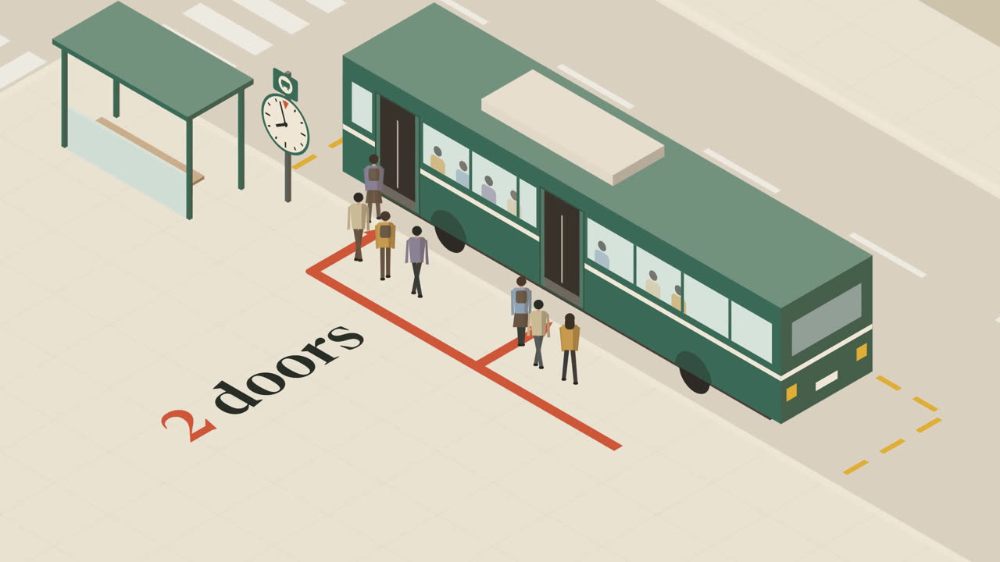<br><sub><b>Two doors on the bus</b> · Isometric Picture Book · style by Lemomo</sub></td>
<td width="33%" valign="top">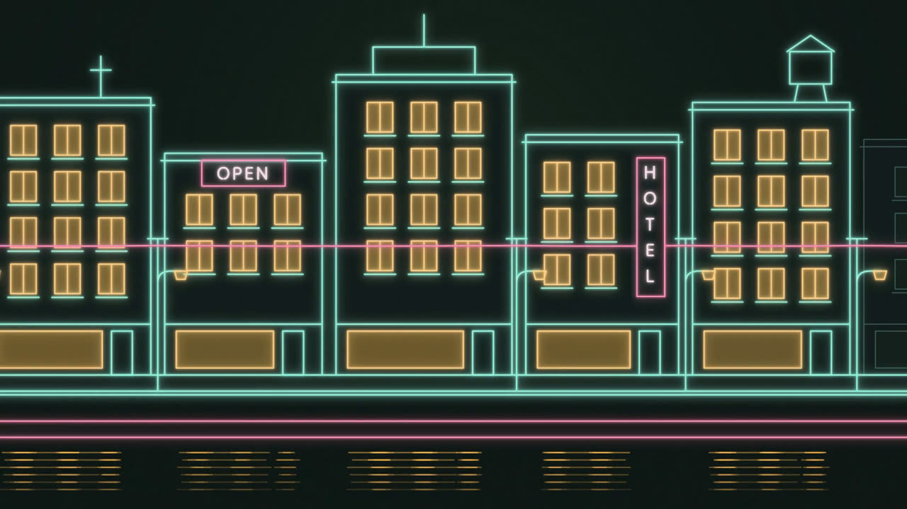<br><sub><b>A city lit to the beat</b> · Music video · style by HeyGen</sub></td>
<td width="33%" valign="top">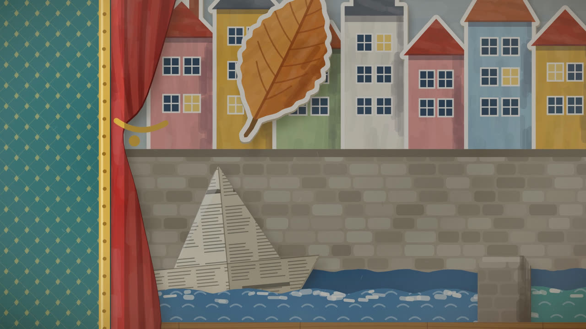<br><sub><b>A toy-theatre town</b> · Toy-theatre paper collage · style by Alex Greenshpun</sub></td>
</tr>
<tr>
<td width="33%" valign="top">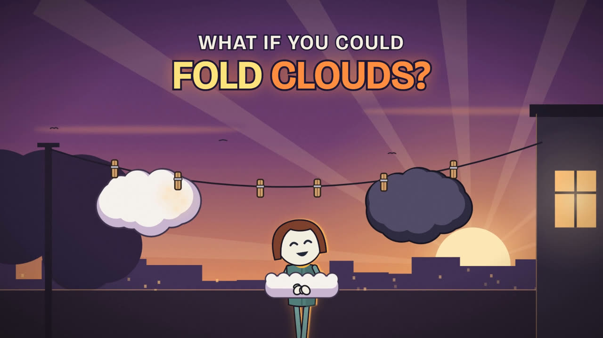<br><sub><b>What if you could fold clouds?</b> · What If · style by FreshStack</sub></td>
<td width="33%" valign="top">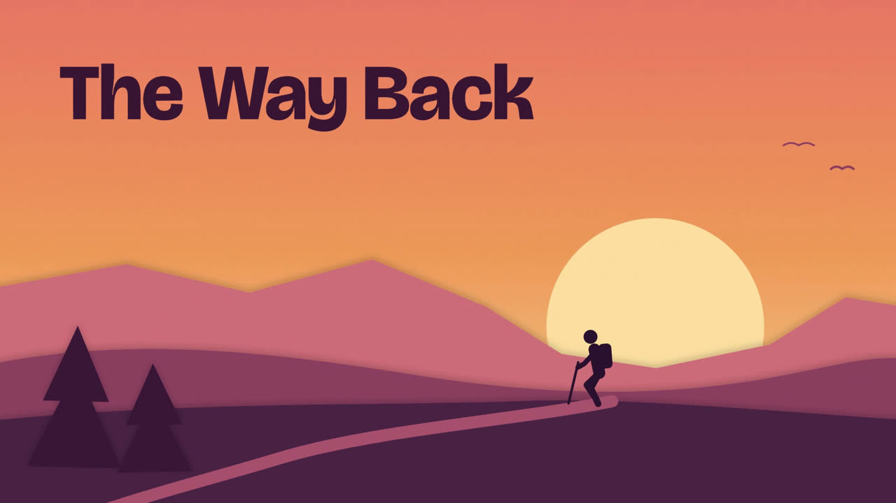<br><sub><b>A day's hike</b> · Slideshow · style by HeyGen</sub></td>
<td width="33%" valign="top"><br><sub><b>A puzzle cube comes apart</b> · 3D · style by HeyGen</sub></td>
</tr>
</table>

<p align="center">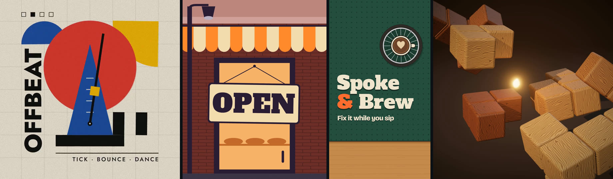<br>
<sub>Every format the style allows: <b>Geometric Bauhaus</b> (style by Vincentwei1021) 1:1 · <b>a bakery opens</b> (General Style by Moworks) 4:5 ·
<b>Spoke &amp; Brew</b> (Vertical · style by HeyGen) 9:16 · <b>a puzzle cube</b> (3D · style by HeyGen) 1:1</sub></p>

<table>
<tr>
<td width="50%" valign="top">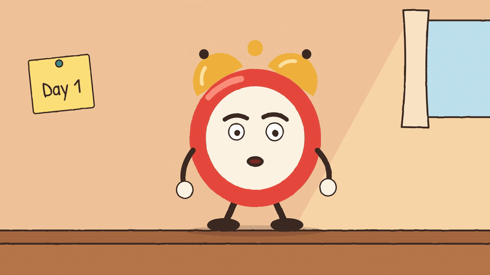<br><sub><b>An alarm clock's first day</b> · Character · style by HeyGen</sub></td>
<td width="50%" valign="top">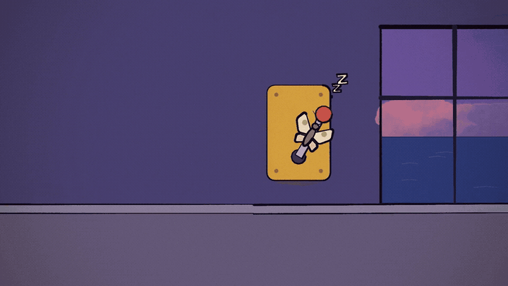<br><sub><b>The lighthouse cat</b> · Brush cartoon · style by John Heibel, acted by a character drawn in the app's Character maker</sub></td>
</tr>
</table>

## More in the app

| Screen | What it holds |
|---|---|
| **Projects** | Your films, newest first; each opens in the Editor |
| **Brand Kits** | A brand's colours, fonts and components, worn by a whole film. HyperFrames' 13 frame presets ship ready to use; make your own from a brand guideline (PDF, PowerPoint or pictures) and check it before use |
| **Film Styles** | The gallery above, with demo films, credits and AE badges |
| **Motion Library** | Motions (from Magic UI, Codrops and Motion Reference), Blocks (448 HyperFrames registry blocks and components) and Vocabulary (168 motion terms from Motion Prompt), each with its author, source and licence |
| **Characters** | The project's characters: drawn with the Character maker, or from the Anidoodle author's own character rigs |
| **Settings** | General (Claude account, projects folder, appearance, voice-over, render), Director (Claude model and effort), System (components and health), Update |

<table>
<tr>
<td width="50%" valign="top">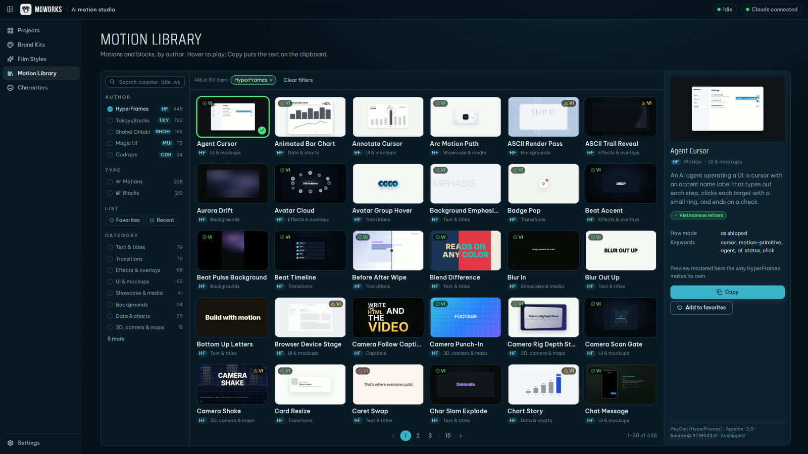<br><sub>Motion Library: every item with a preview, its author, source and licence</sub></td>
<td width="50%" valign="top">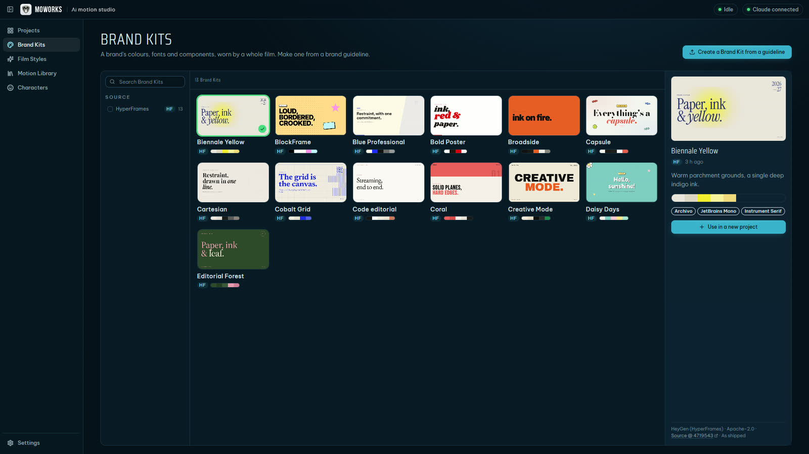<br><sub>Brand Kits: HyperFrames' 13 frame presets and your own</sub></td>
</tr>
</table>

## Requirements

| | |
|---|---|
| **System** | Windows 10 or 11, 64-bit; several GB of free disk for the app and its components, plus room for your projects |
| **Node.js** | 22 or newer ([nodejs.org](https://nodejs.org)) |
| **Git** | [Git for Windows](https://git-scm.com/download/win) |
| **Claude Code** | Installed and signed in with a Claude account that includes Claude Code ([claude.com/claude-code](https://claude.com/claude-code)) |
| **Python** | 3.12, `winget install -e --id Python.Python.3.12 --scope user` (or [python.org](https://www.python.org/downloads/)): reading PSD / PowerPoint / PDF, music beats, lyric timing, the After Effects port |
| **FFmpeg** | 9.0, installed once with `winget install Gyan.FFmpeg --version 9.0` (the first-run screen shows the command) |
| *Optional* | An ElevenLabs or Fish Audio API key for voice-overs · After Effects for the AE port · an NVIDIA graphics card (4 GB or more) to transcribe voice-overs faster |

## Quick start

1. **Prerequisites** (details under [Requirements](#requirements)): Windows 10 or 11, [Git](https://git-scm.com/download/win),
   [Node.js](https://nodejs.org) 22 or later, Python 3.12, FFmpeg 9.0 and Claude Code signed in with your Claude account. Python and
   FFmpeg install with winget, and the first-run screen shows the same lines if either is missing:
   ```bash
   winget install -e --id Python.Python.3.12 --scope user
   winget install Gyan.FFmpeg --version 9.0
   ```
2. **Accept the GitHub invitation** to this repository, then clone it into an `app` folder inside a folder of its own:
   ```bash
   git clone https://github.com/moworksstudio/moworks-studio "Moworks Studio\app"
   ```
   The app keeps your work next to the clone, so the folder ends up like this:
   ```
   Moworks Studio\
     app\       ← the clone: code, installed HyperFrames, settings
     projects\  ← films
     library\   ← Brand Kits, characters, the library
     models\    ← only when Whisper is installed
   ```
   Use a local disk, not a synced folder (Google Drive, OneDrive, Dropbox): sync locks files while films render. The first-run
   screen lets you choose another work folder.
3. **Double-click `Moworks Studio\app\Moworks Studio.bat`**. The first time, it installs the app's packages (about 80 MB) and builds the
   interface, then opens the app window. Later starts take a few seconds.
4. **Finish in the app**, one screen at a time. Choose a look (The Desk or The Studio); then **Set up Moworks Studio** lists only what
   you still need to do or download: the work folder, then **Download all**. Anything you skip stays in Settings › System. Then click the
   Claude chip in the top bar to sign in; Claude Code's own sign-in opens in the browser and the app never sees your password.

   | Component | Size | |
   |---|---|---|
   | HyperFrames 0.8.214 and its Chrome | about 550 MB | downloaded by **Download all** |
   | Python components (After Effects export, PSD / PowerPoint / PDF reading, music beats, lyric timing) | about 160 MB | downloaded by **Download all** |
   | Whisper, for voice-over and lyric timing | about 1.7 GB with its engine | optional |
   | Whisper's CUDA libraries, on an NVIDIA graphics card | about 1.3 GB | optional, offered only on a suitable card |
   | FFmpeg 9.0 | installed by winget, not by the app | you run the winget line the screen shows |
   | HyperFrames' skills and registry, fonts, code libraries, film-style sources, the library | in the repository | nothing to download |
5. **Add a voice key** *(optional)*: Settings › General › Voice-over. The key is encrypted for your Windows account.
6. **Make a film:** Projects › New project.

### Or let Claude do it

Paste this into Claude Code:

> Install Moworks Studio from https://github.com/moworksstudio/moworks-studio: clone it and follow its CLAUDE.md.

Claude follows the repository's `CLAUDE.md`: it checks Git, Node.js 22, Python 3.12 and FFmpeg 9.0 (and asks before installing what is
missing), clones into `Moworks Studio\app` and runs `Moworks Studio.bat`; the app's first-run screen does the rest.

## Walkthrough

A 30-second film, from brief to MP4:

1. **New project.** Give it a title, choose a film style and the format (size and length), and paste a brief ("A 30-second story about
   the 1904 Olympic marathon, 4:5, Vietnamese voice-over"). Add a Brand Kit, characters and assets if you have them. **Create project.**
2. **Prepare.** Claude reads everything and may stop with a question ("The style is a silent film; keep the voice-over or use title
   cards?"). Answer in the chat; Claude writes `BRIEF.md`.
3. **Voice-over.** The Voice screen opens with the script filled in. Choose a voice and generate it; Whisper times the words automatically
   (an optional download of about 1.7 GB, offered the first time) and the storyboard starts on its own.
4. **Storyboard.** Read the board. Comment on a panel (`@Panel_3: make the runner smaller`) or approve.
5. **Motion Plan.** Check the timings and motion of every shot. **Approve and build** shows the estimated time and usage.
6. **Build, Review, Final Mix, Tech checks** run one after the other. The pipeline shows what is running and the time left; the chat shows
   what Claude is doing.
7. **Play** the film in the Editor. Ask Claude for changes in the chat (click an element first to point at it), or edit its words by hand.
8. **Render** an MP4, and **Port to After Effects** if the style's badge allows it.

<p align="center">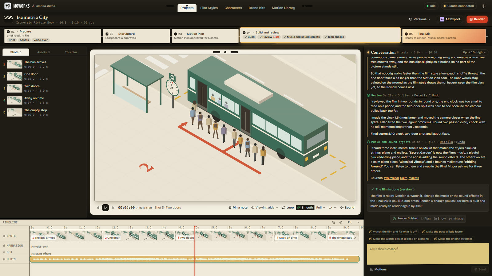<br><sub>A finished film in the Editor (The Studio): the five steps along the top, Claude's notes from Review and Final Mix on the right</sub></p>

As a reference, a 34-second film in a Lemo-Opuscar style took 1 h 17 min from Create to the finished MP4, of which 44 minutes from
**Approve and build**; Claude usage for the whole film was worth about US$13 at API prices.

## Where files live

| Folder | Contents | In git |
|---|---|---|
| `app\` | This repository: the app's source, config, rule packs and the bundled third-party sources | yes |
| `app\runtime\` | Settings, encrypted keys, installed HyperFrames versions, logs | no |
| `projects\` (next to `app\`, in the work folder) | Your films: one folder each, with `BRIEF.md`, boards, compositions, audio, `CREDITS.md` and `renders\` | no |
| `library\`, `models\` (next to `app\`, in the work folder) | The library, Brand Kits and your characters; Whisper, when installed | no |

Settings › General › Projects folder changes where new projects are saved. Every film writes a `CREDITS.md` that credits the music and sound effects it uses (title, author, source, licence); downloaded fonts travel with their licence files.

## Updates

Settings › Update brings the app folder to the newest version of this repository: it fetches, fast-forwards, reinstalls packages when
`package-lock.json` changed, rebuilds the interface, checks that the app starts and restarts it. If any step fails, the folder goes back
to the commit it came from. Only files tracked by git change; your projects, library, settings and keys are never touched.

You can also update by hand: close the app, run `git pull`, `npm install` and `npm run build` in the app folder, and start `Moworks Studio.bat` again.

## Troubleshooting

| Problem | What to do |
|---|---|
| "Node.js was not found" | Install Node.js 22 or newer, then start `Moworks Studio.bat` again |
| The first start stops at "Installing the app's packages" | Check the internet connection; the lines above the message say what failed. Run the .bat again |
| "Claude is not connected" | Click the Claude chip in the top bar and sign in. In a terminal, `claude auth status` shows Claude Code's own state |
| A component shows as missing | Settings › System lists every component with its state and the next step; FFmpeg needs the `winget` command shown there |
| "The local service is not running" | The app's background service stopped. Start `Moworks Studio.bat` again; the log is `runtime\logs\app.log` |
| A style shows a lock | One of its source files no longer matches the pinned version. Settings › System offers to fetch it again |
| A voice-over cannot be made | Add or check the ElevenLabs key in Settings › General › Voice-over; the key needs the text-to-speech permission |
| After Effects port fails | Install After Effects, close any dialog open in it, and port again; the error in the app names the step that failed |

The known limitations are listed in [KNOWN-ISSUES.md](KNOWN-ISSUES.md).

## Privacy

- **Keys stay on this computer.** Service keys (ElevenLabs, Fish Audio) are encrypted with Windows DPAPI for your Windows account. They
  never reach the browser, the logs, project files or render processes.
- **Claude** runs through Claude Code under your own account; the app never handles your password.
- **Projects stay local.** Briefs, assets and films live in your projects folder. Claude reads them through Claude Code to do the work;
  nothing else uploads them.
- **App backup:** off unless a backup folder (`storage.backupRoot`) is set in this computer's local settings.
- **No telemetry.** HyperFrames telemetry and update checks are turned off; the app sends no usage data. Network access is limited to the
  services you use (Claude, the voice service, Mixkit and Openverse when you ask for music or sound effects, and component downloads).

## For developers

| Command | What it does |
|---|---|
| `npm start` | Starts the app's local server (the launcher does this for you) |
| `npm run build` | Builds the interface into `ui/dist` |
| `npm run dev:ui` | Interface with hot reload, for interface work |
| `npm test` | The full test suite (about 30 minutes; close HyperFrames Studio first if you have it open) |

On a new computer, the tests that render or check films need the components first: run **Download all** on the first-run screen and
install FFmpeg, or they fail. Two tests also compare against a golden render that is not stored in the repository (`test-output/` is
ignored); make it once before running the suite, or `test/edit.test.mjs` and `test/gpu.test.mjs` fail:

```bash
node tools/golden/run.mjs --label G214 --only hf-native-30
```

## Documentation

| Document | Contents |
|---|---|
| [CHANGELOG.md](CHANGELOG.md) | What this version contains |
| [KNOWN-ISSUES.md](KNOWN-ISSUES.md) | Open issues and limitations, with workarounds |
| [THIRD-PARTY.md](THIRD-PARTY.md) | Every bundled or downloaded source: author, link at the pinned commit, licence, how it is used |
| [DESIGN.md](DESIGN.md), [PRODUCT.md](PRODUCT.md) | The interface's design system and product principles |

## Technology

| Component | Role |
|---|---|
| [HyperFrames](https://github.com/heygen-com/hyperframes) 0.8.214 (HeyGen, Apache-2.0) | The open-source render engine, pinned and used unmodified: composition format, player, lint, renderer, skills and registry |
| Claude Code (Anthropic) | Runs every Claude task: Prepare, Storyboard, Motion Plan, Build, Review, the chat |
| Node.js, React 18, Vite | The app's local server and interface |
| GSAP, three.js, p5.js / p5.brush, d3 | Animation runtimes copied into each film so it plays and renders offline |
| Chromium headless shell, FFmpeg | Frame capture and encoding |
| faster-whisper (Whisper large-v3 turbo) | Word timings of voice-overs, on the CPU or an NVIDIA GPU |
| ExtendScript + Python | The After Effects port |

## Origin and credits

Renders with the open-source [HyperFrames](https://github.com/heygen-com/hyperframes) engine (HeyGen, Apache-2.0), pinned at 0.8.214
and used unmodified.

Moworks Studio grew out of **[Moworks Motion](https://github.com/moworksstudio/moworks-motion)**, Moworks' earlier motion kit for Claude
Code: its process, taste and review rules became the app's General Style and app-wide rule packs. The other film styles are the work of
HeyGen, Lemomo, Vincentwei1021, Alex Greenshpun, John Heibel and FreshStack, used as their authors ship them. The full list, with links
at the exact commits and licences, is in [THIRD-PARTY.md](THIRD-PARTY.md).

## Licence

Free for personal, non-commercial use by invited users only; no redistribution, sale or sharing, including modified versions
([LICENSE](LICENSE)). © 2026 Moworks. Third-party components keep their own licences, listed in [THIRD-PARTY.md](THIRD-PARTY.md);
nothing in this licence limits them.
