<h1 align="center">Moworks Studio</h1>

<p align="center"><b>English</b> · <a href="README.vi.md">Tiếng Việt</a></p>

<p align="center"><b>A desktop studio for motion-graphic films: Claude directs, the app builds and checks every frame, you approve each step.</b></p>

<p align="center">
  
  
  
  
  
  
</p>

<p align="center">
  <a href="#quick-start">Quick start</a> ·
  <a href="#how-a-film-is-made">How a film is made</a> ·
  <a href="#features">Features</a> ·
  <a href="#film-styles">Film styles</a> ·
  <a href="#troubleshooting">Troubleshooting</a> ·
  <a href="CHANGELOG.md">Changelog</a>
</p>

Write a brief, add your material and pick a film style. Claude plans the film, draws a storyboard and writes a Motion Plan for you to
approve; Moworks Studio then builds the film in code shot by shot, adds music and sound, checks it and renders it as MP4, MOV or WebM,
in one size or several, or as an editable After Effects project. Everything runs on your Windows PC under your own Claude account.

<p align="center">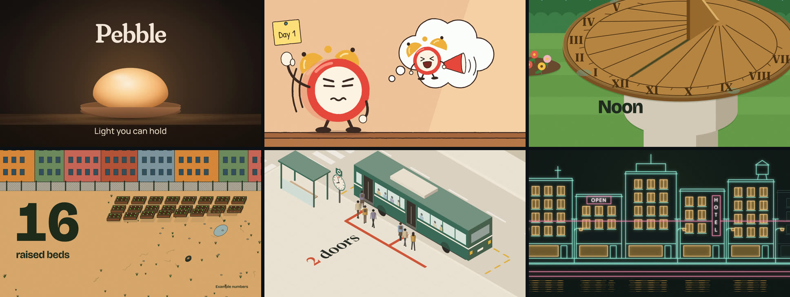</p>
<p align="center"><sub>Demo films made in the app, each in a different film style.</sub></p>

> **Status: preview.** The app still changes quickly; expect rough edges.

## New in 0.8.214.7

- **Thumbnails:** pick a frame of a film; Claude lays it out at 16:9 or 9:16, on its own or with your Brand Kit.
- **One film, several sizes:** Adaptation makes 9:16, 1:1 and other sizes of a film; each renders with the film's own mix.
- **Casting:** four more ways to make a character, one character sheet, more ready-made characters, and a Characters drawer in the Film Editor.
- **Subtitles** saved as .srt and .vtt beside the render.
- **Sound:** voice peaks held at −1 dBTP; Version 1 sounds as the export will.
- **After Effects:** sound levels and mutes come across, the film's background comes in as a layer.

The full list is in the [CHANGELOG](CHANGELOG.md).

## How a film is made

<p align="center">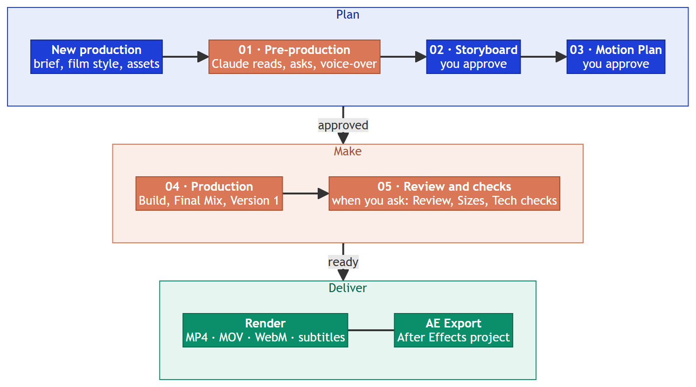</p>

| Step | What happens |
|---|---|
| **New production** | Title, film style, size and length, Brand Kit, characters, the brief and your assets (artwork, PSD, deck, pictures, music, a script) |
| **01 · Pre-production** | Claude reads everything and stops to ask when the brief and the style disagree. The voice-over is made here (ElevenLabs, or the free Kokoro voice) and timed word by word |
| **02 · Storyboard** | A board drawn shot by shot, with the reason for each shot. You approve or comment |
| **03 · Motion Plan** | Every shot's motion in numbers: timings, distances, easings, sound cues. You approve and build |
| **04 · Production** | The film is built in code, shot by shot, then music and sound effects are mixed (Standard −14 LUFS, or Quieter −16 LUFS). You watch **Version 1** |
| **05 · Review and checks** | Only when you ask: Claude watches its film, scores it out of 10 and fixes it; **Sizes** adds other frames; **Tech checks** report contrast, overlaps, stills and sound in plain words |
| **Render · AE Export** | MP4, MOV or WebM with subtitles if you want them, or an After Effects project |

In the **Film Editor** the film plays frame by frame as it will render. Click any words in the frame to edit them, or press **Pin a
note** (N) and mark a point on the picture: the note reaches Claude with the moment, the shot and the place. The timeline holds the
narration, effects and music; their levels change as you drag them.

<p align="center">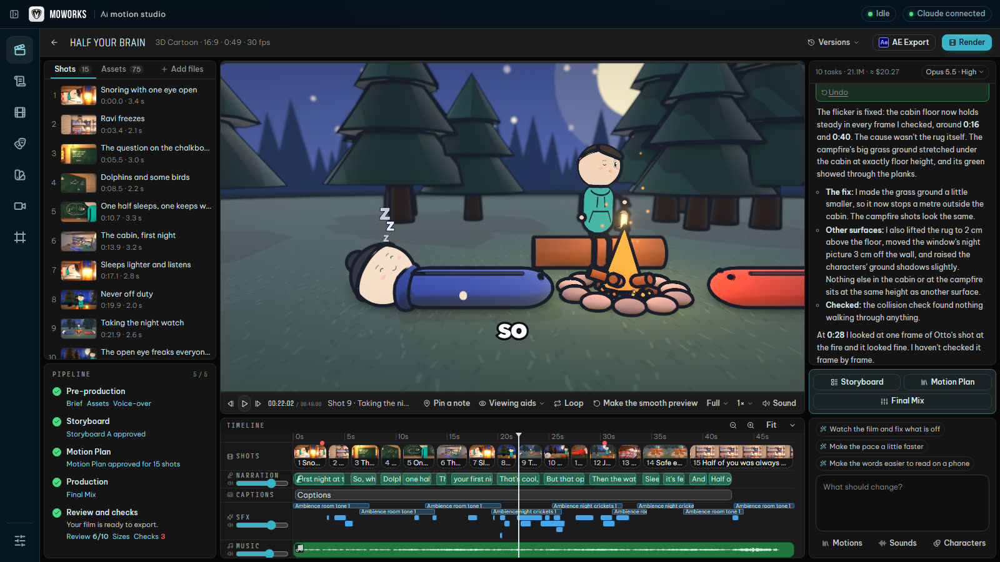<br><sub>The Film Editor (The Desk)</sub></p>

**After Effects.** Each film style carries a badge measured on a demo film of that style:

| Badge | What After Effects gets | Styles |
|---|---|---|
| **AE editable** | Text and shapes as layers you can edit | 6 |
| **AE partly editable** | Some parts as layers, the rest as video | 93 |
| **AE video only** | The film as one video layer | 10 |
| **AE not checked yet** | Not measured yet: the export still works, the result is not known in advance | 24 |

## Features

| Page | What it does |
|---|---|
| **Productions** | Your films, newest first; each opens in the Film Editor. **New production** starts one |
| **Writers' Room** | **Research** pitches ideas in a film style's own way, with checked sources; **Pitches** keeps yours and the samples; **Scripts** writes an idea scene by scene and starts a production from it |
| **Film Styles** | 133 styles by author, each with a demo film, credits and its AE badge |
| **Casting** | The characters who act in your films, at their real heights. Claude makes one from your brief in the drawing style of your film (hand-drawn media, Brush cartoon, 3D Cartoon, What If, 2D Explainer, Stickman Explainer, Ricks Clip…), or use one of the 34 that come with the app |
| **Brand Kits** | A brand's colours, fonts, logos and components, worn by a whole film. HyperFrames' 13 frame presets ship ready; make your own from a brand's folder (PDF, PowerPoint, pictures, fonts, AI, PSD, ZIP) |
| **Motion Library** | 889 motions, 454 blocks and components and 192 motion terms, each with a preview, by type and category |
| **Thumbnails** | A cover picture for a film at 16:9 and 9:16, from a frame you pick |
| **Studio Settings** | Claude account and model, projects folder, appearance, render, voice-over, components, updates |

Two themes with the same features, chosen at the first start (Studio Settings › General › Appearance changes it): **The Desk**, a
dark workspace with a left rail, and **The Studio**, a light-table workshop of paper, pegboard and pinned boards.

<table>
<tr>
<td width="50%" valign="top">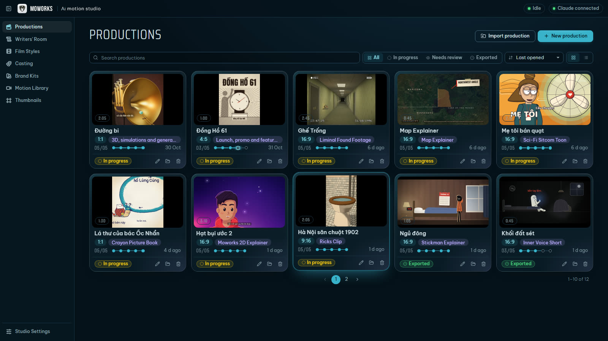<br><sub>Productions · The Desk</sub></td>
<td width="50%" valign="top">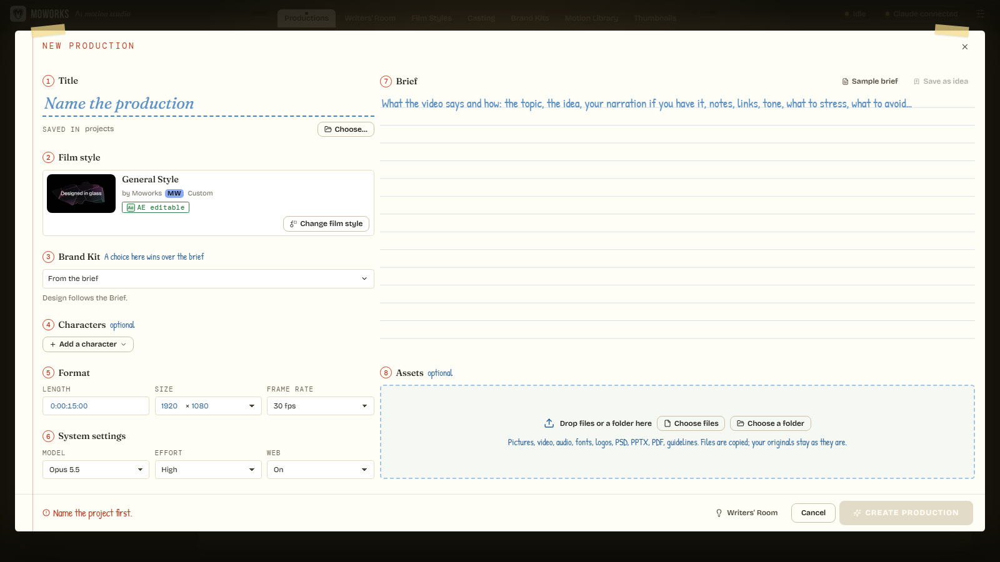<br><sub>New production · The Studio</sub></td>
</tr>
<tr>
<td width="50%" valign="top">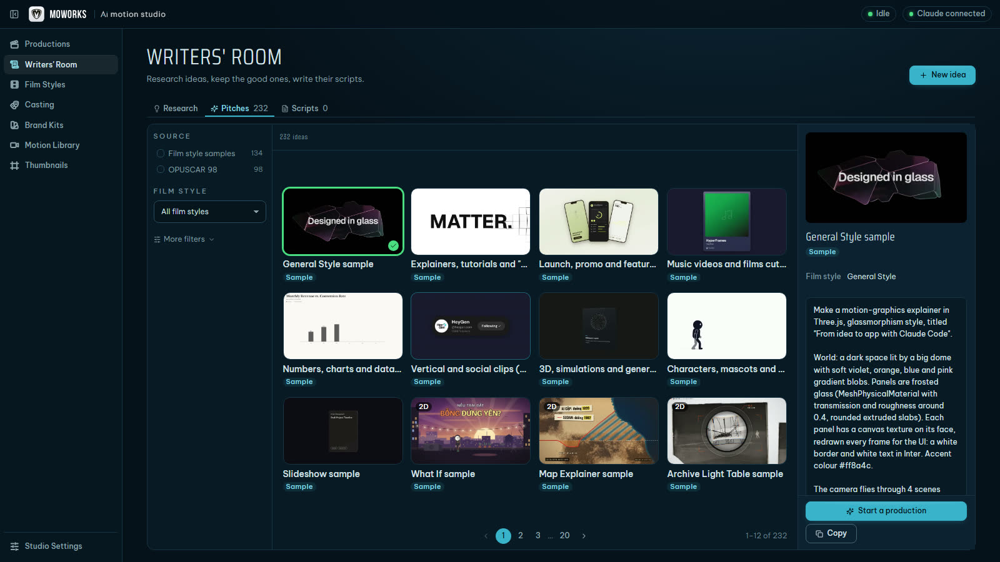<br><sub>Writers' Room · The Desk</sub></td>
<td width="50%" valign="top">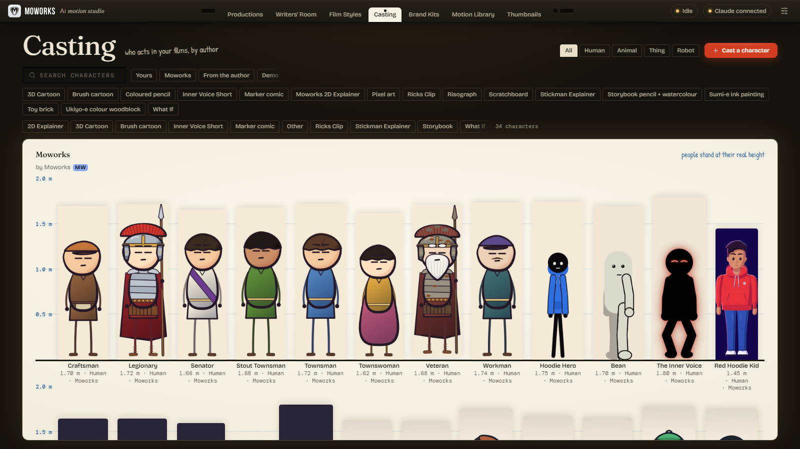<br><sub>Casting · The Studio</sub></td>
</tr>
<tr>
<td width="50%" valign="top">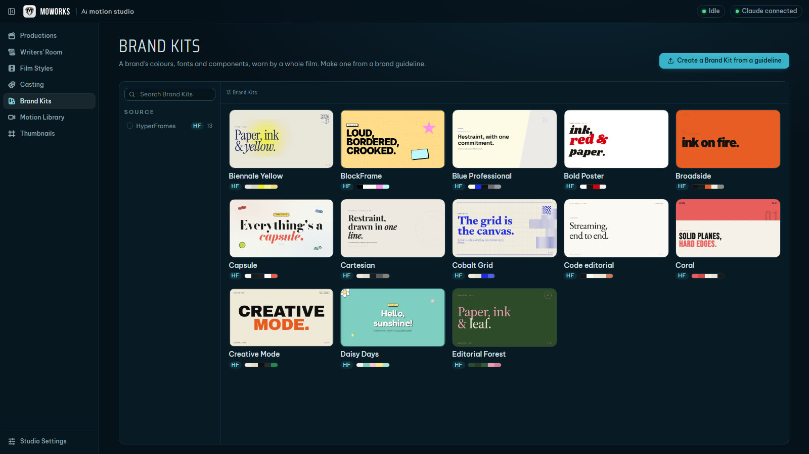<br><sub>Brand Kits · The Desk</sub></td>
<td width="50%" valign="top">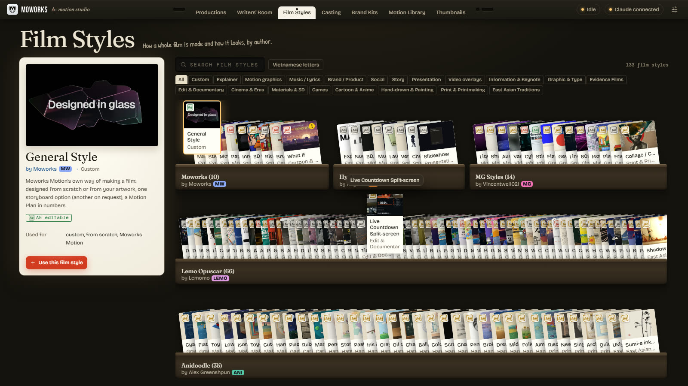<br><sub>Film Styles · The Studio</sub></td>
</tr>
<tr>
<td width="50%" valign="top">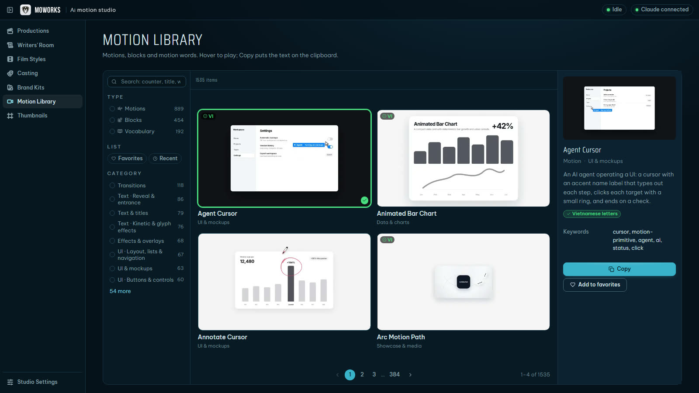<br><sub>Motion Library · The Desk</sub></td>
<td width="50%" valign="top">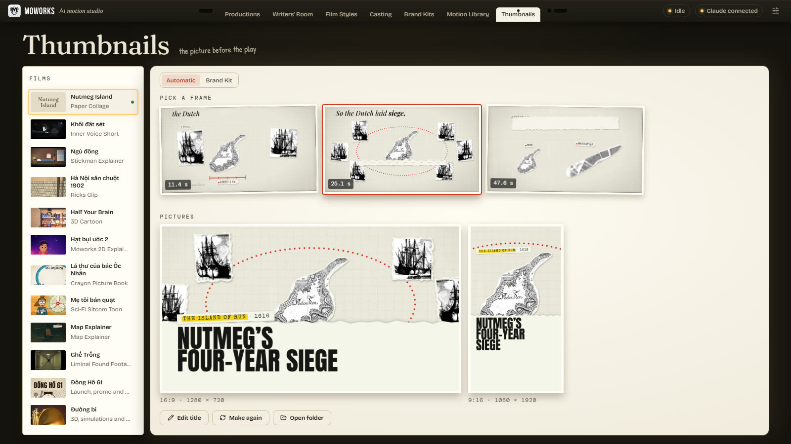<br><sub>Thumbnails · The Studio</sub></td>
</tr>
</table>

<details>
<summary>The same pages in the other theme</summary>

<table>
<tr>
<td width="50%" valign="top">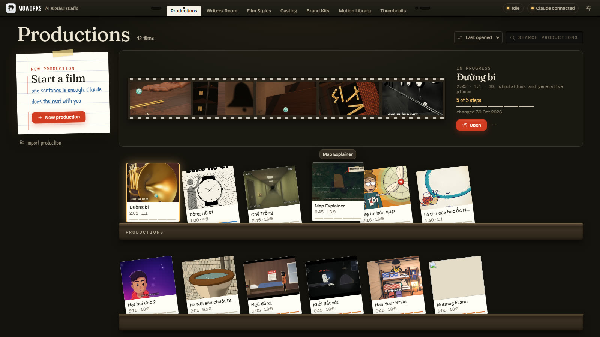<br><sub>Productions · The Studio</sub></td>
<td width="50%" valign="top">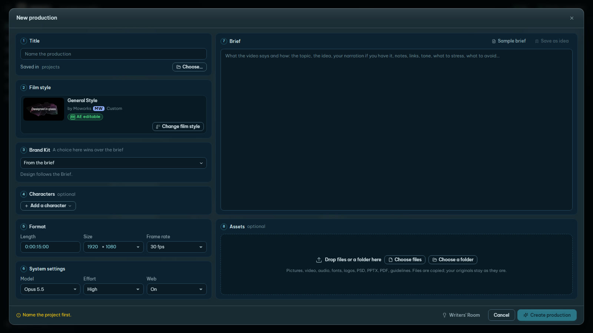<br><sub>New production · The Desk</sub></td>
</tr>
<tr>
<td width="50%" valign="top">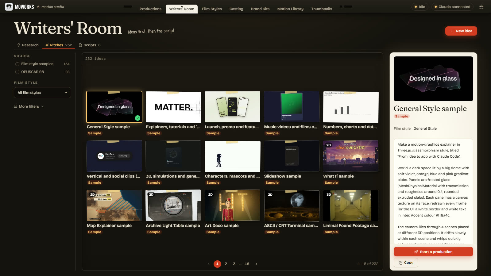<br><sub>Writers' Room · The Studio</sub></td>
<td width="50%" valign="top">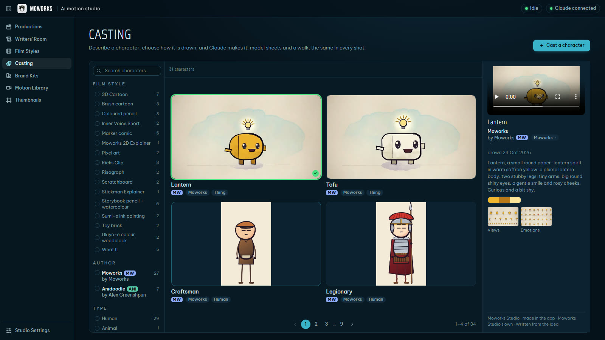<br><sub>Casting · The Desk</sub></td>
</tr>
<tr>
<td width="50%" valign="top">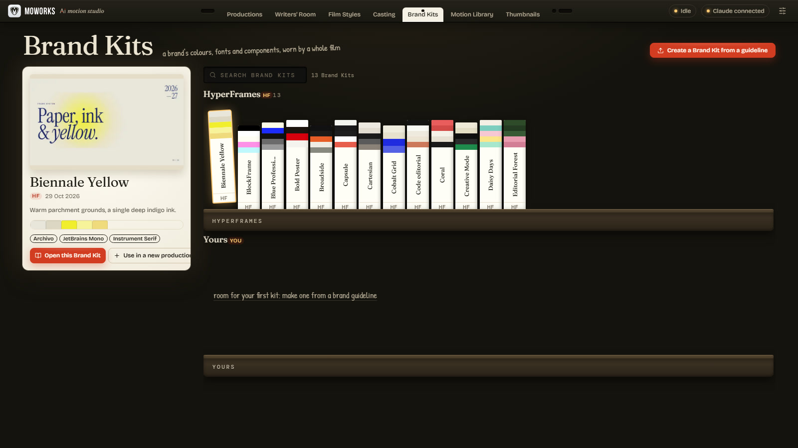<br><sub>Brand Kits · The Studio</sub></td>
<td width="50%" valign="top">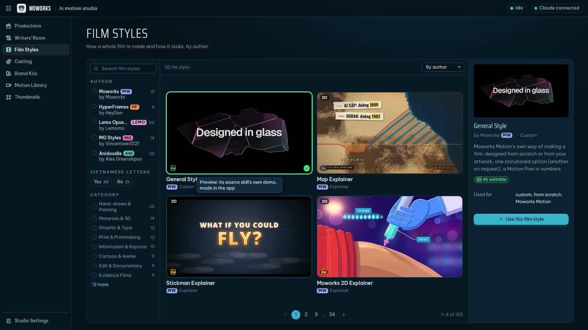<br><sub>Film Styles · The Desk</sub></td>
</tr>
<tr>
<td width="50%" valign="top">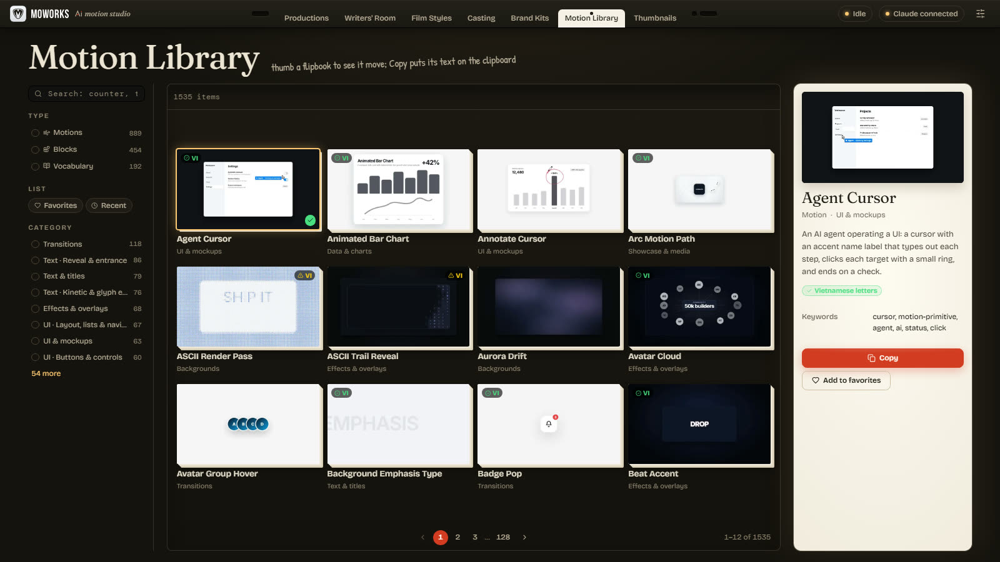<br><sub>Motion Library · The Studio</sub></td>
<td width="50%" valign="top">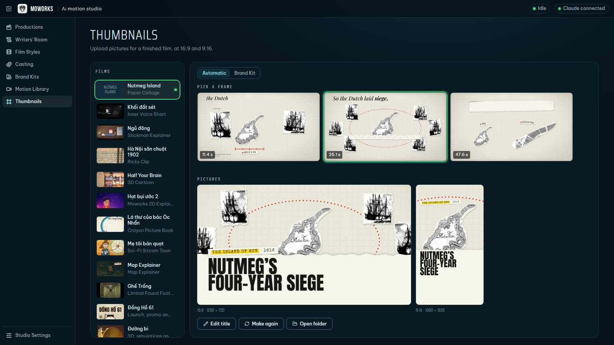<br><sub>Thumbnails · The Desk</sub></td>
</tr>
<tr>
<td width="50%" valign="top">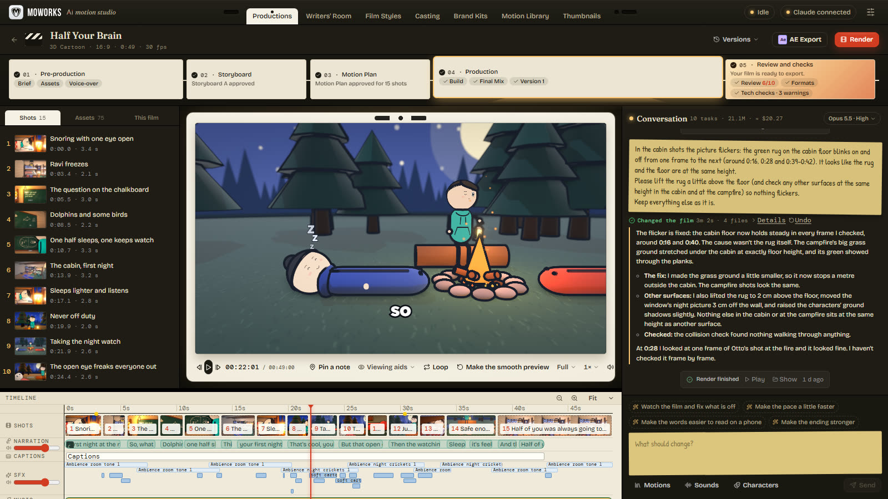<br><sub>Film Editor · The Studio</sub></td>
<td width="50%" valign="top"></td>
</tr>
</table>
</details>

**Characters that come with the app (34):** Mira, Theo, Bit, the cheetah, Bơ, Firefighter and Grandma (hand-drawn, Anidoodle); Mika,
Ravi, June, Otto, Bea, Leo and Noor (3D Cartoon); Pip, Mo, Sis, Mum and Suit (What If); eight Romans of Ricks Clip; Hoodie Hero
(Stickman Explainer); the hero and his shadow (Inner Voice Short); Red Hoodie Kid (2D Explainer); and the demo characters Clawd,
Lantern and Tofu. They stay in the app's own folder, so an update never mixes them with the characters you make.

**Sizes.** One film can have several frames: the master (16:9, for example) plus 9:16, 1:1 or 4:5, each re-laid out for its frame
and rendered with the film's own mix.

<p align="center">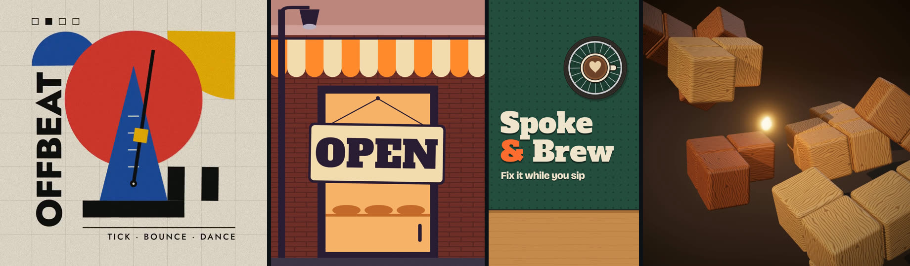<br><sub>1:1 · 4:5 · 9:16 · 1:1</sub></p>

## Film styles

A film style sets the whole look and the rules Claude follows. Third-party style files are used as their authors ship them, pinned at
one commit; each card in Film Styles names its author, licence and source.

| Set | Author | Styles | Licence | Source |
|---|---|---|---|---|
| **Moworks** | Moworks | 3: **General Style**; **Map Explainer** (a paper map and the real ground under one camera); **Brush cartoon** (a brush-drawn cartoon acted by the project's characters) | the app's own work. Map data [Natural Earth](https://www.naturalearthdata.com), [world-atlas](https://github.com/topojson/world-atlas/tree/v2.0.2), satellite pictures [EOX](https://cloudless.eox.at) (CC BY 4.0). Brush cartoon is built on John Heibel's ClaudeAnimationBase (MIT; p5.js LGPL-2.1, p5.brush MIT) | made for the app; Brush cartoon from [JohnHeibel/ClaudeAnimationBase @ `0ac8bf2`](https://github.com/JohnHeibel/ClaudeAnimationBase/tree/0ac8bf2b31942376cb6b8c4074715595d512acd2) |
| **Moworks film styles** | Moworks Studio | 7: Paper Collage, Stickman Explainer, Inner Voice Short, 3D Cartoon, Moworks 2D Explainer, Ricks Clip, What If (on FreshStack's MIT engine) | the app's own work | the app's own source skills; outside parts in [THIRD-PARTY.md](THIRD-PARTY.md) |
| **HyperFrames** | HeyGen | 8: Slideshow, Explainer, Launch, Music video, Data, Vertical, 3D, Character | Apache-2.0 | [heygen-com/hyperframes @ `4719543`](https://github.com/heygen-com/hyperframes/tree/4719543e972548a261b8354f0a8dada479ae5d93/skills) (v0.8.214) |
| **Lemo-Opuscar** | Lemomo (LemoLab) | 66 code-built styles (cinema eras, documentary, editorial, data…; Memphis Diorama by EianLu) | MIT; demo stills CC BY 4.0 | [lemomo-ai/lemo-opuscar @ `bebbbe1`](https://github.com/lemomo-ai/lemo-opuscar/tree/bebbbe1aa92a3cb4bb6f83500e61b23a17d1aa00) |
| **mg-styles-15** | Vincentwei1021 | 14 motion-design styles (the Blender-based 3D style is not offered) | MIT | [Vincentwei1021/mg-styles-15 @ `49052d8`](https://github.com/Vincentwei1021/mg-styles-15/tree/49052d80bfaf9fa8412cc9710530e5e95a3b8d8c) |
| **Anidoodle** | Alex Greenshpun (10x Company) | 35 hand-drawn media (32 media + 3 house styles) | Apache-2.0 with NOTICE | [alexgreensh/anidoodle @ `4ae27d2`](https://github.com/alexgreensh/anidoodle/tree/4ae27d2c281fcfd01bce87ab13dc5ad4df81a795) (v0.10.1) |

Every style also follows two app-wide rules: **the film stays alive** (no frame holds still for more than two seconds) and **stop and
ask** (a conflict or a missing asset is a question for you, never a silent guess).

### Made in the app

<table>
<tr>
<td width="33%" valign="top">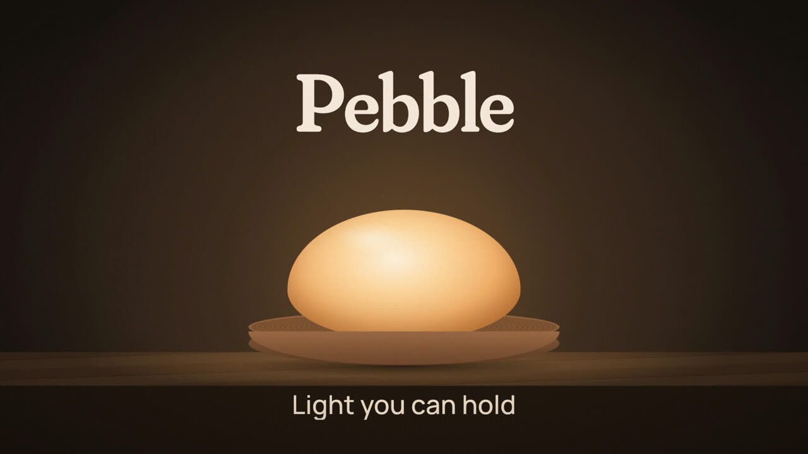<br><sub><b>Pebble, a lamp launch</b> · Launch · HeyGen</sub></td>
<td width="33%" valign="top">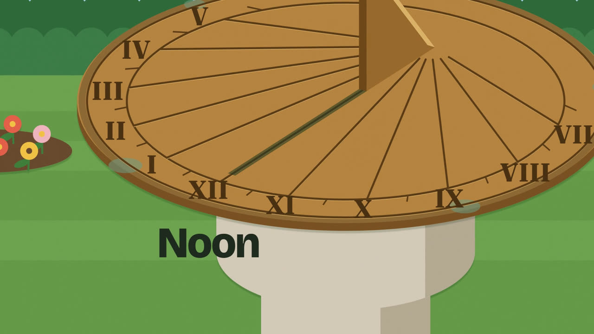<br><sub><b>How a sundial works</b> · Explainer · HeyGen</sub></td>
<td width="33%" valign="top">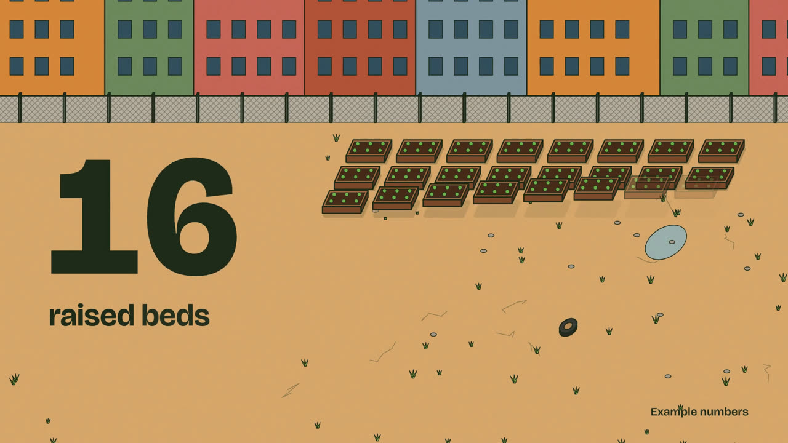<br><sub><b>A community garden in numbers</b> · Data · HeyGen</sub></td>
</tr>
<tr>
<td width="33%" valign="top">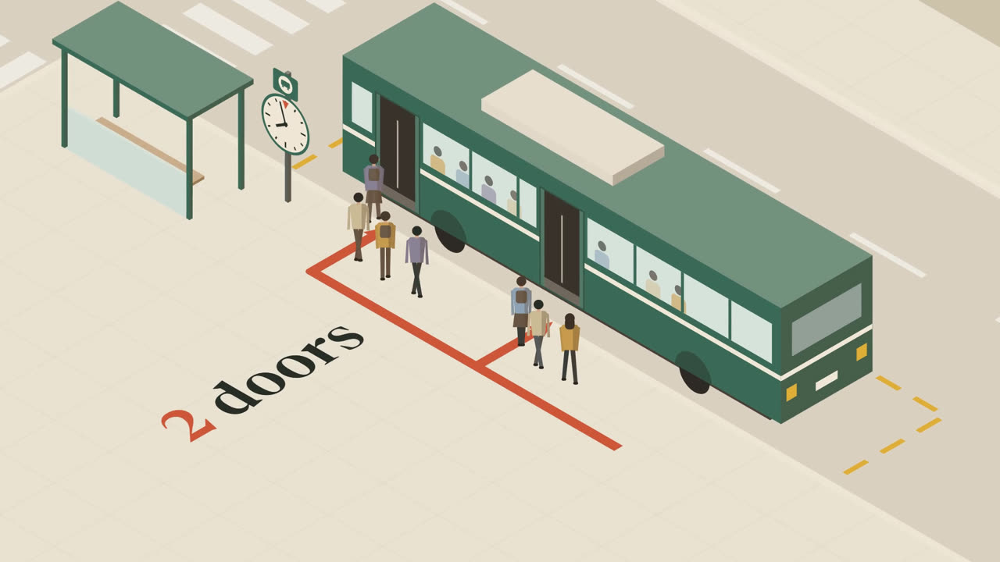<br><sub><b>Two doors on the bus</b> · Isometric Picture Book · Lemomo</sub></td>
<td width="33%" valign="top">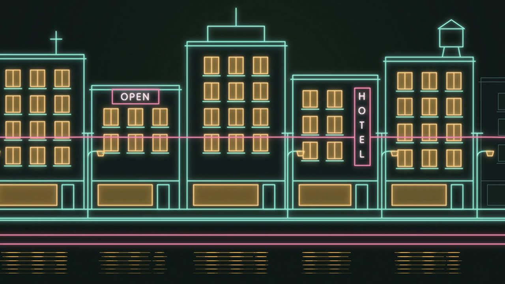<br><sub><b>A city lit to the beat</b> · Music video · HeyGen</sub></td>
<td width="33%" valign="top">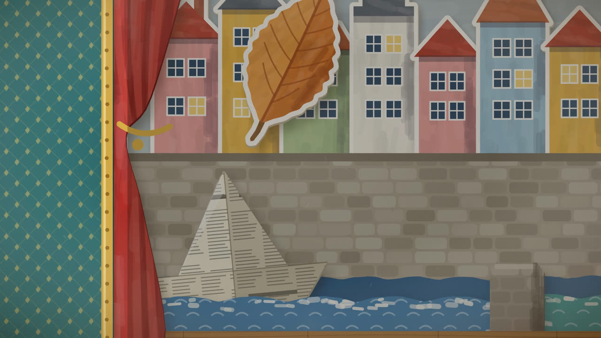<br><sub><b>A toy-theatre town</b> · Toy-theatre paper collage · Alex Greenshpun</sub></td>
</tr>
<tr>
<td width="33%" valign="top">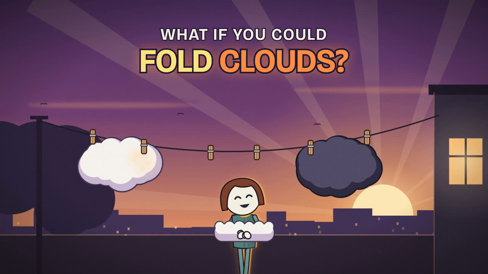<br><sub><b>What if you could fold clouds?</b> · What If · Moworks Studio</sub></td>
<td width="33%" valign="top">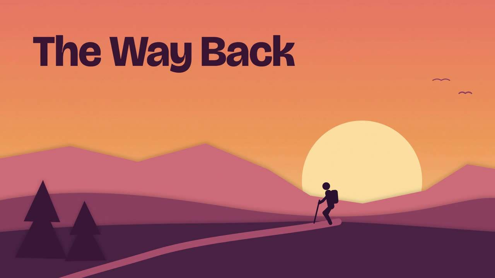<br><sub><b>A day's hike</b> · Slideshow · HeyGen</sub></td>
<td width="33%" valign="top"><br><sub><b>A puzzle cube comes apart</b> · 3D · HeyGen</sub></td>
</tr>
<tr>
<td width="33%" valign="top">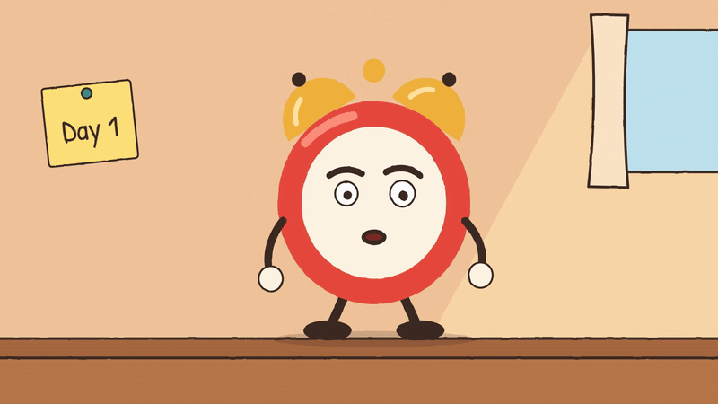<br><sub><b>An alarm clock's first day</b> · Character · HeyGen</sub></td>
<td width="33%" valign="top">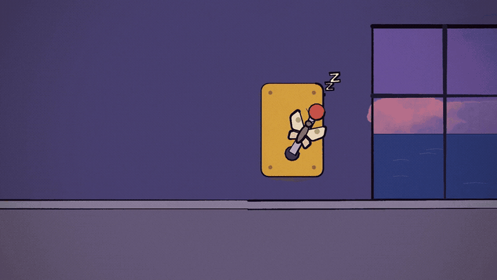<br><sub><b>The lighthouse cat</b> · Brush cartoon · Moworks</sub></td>
<td width="33%" valign="top"></td>
</tr>
</table>

## Requirements

| | |
|---|---|
| **System** | Windows 10 or 11, 64-bit; several GB of free disk, plus room for your films |
| **Needed first** | [Git for Windows](https://git-scm.com/download/win), [Node.js](https://nodejs.org) 22 or newer, and Claude Code (the Claude desktop app includes it) with a Claude account that includes it |
| **Installed by the app** | HyperFrames 0.8.214 and its Chrome, Python 3.12, FFmpeg 9.0, the Python components and the speech-to-text model (Whisper turbo): about 2.6 GB in all |
| *Optional* | An ElevenLabs key for voice-overs (or the free Kokoro voice, about 375 MB, no Vietnamese) · After Effects for AE Export · an NVIDIA card (4 GB or more) to time voice-overs faster |

## Quick start

1. Install Git, Node.js 22+ and Claude Code.
2. Clone into an `app` folder inside a folder of its own, on a local disk (not Google Drive, OneDrive or Dropbox: sync locks files while films render):
   ```bash
   git clone https://github.com/moworksstudio/moworks-studio "Moworks Studio\app"
   ```
3. Double-click `Moworks Studio\app\Moworks Studio.bat`. The first start installs the app's packages (about 80 MB) and opens the window.
4. In the app: choose a theme, then **Set up Moworks Studio**: pick the folder for your films and press **Install**. Click the Claude chip
   in the top bar to sign in (Claude Code's own sign-in; the app never sees your password).
5. *Optional:* add an ElevenLabs key in Studio Settings › System › Voice-over. Then **Productions › New production**.

Your work sits next to the app: `projects\` (films), `library\` (Brand Kits, your characters), `models\` (when Whisper is installed).

### Or let Claude do it

Paste this into Claude Code:

> Install Moworks Studio from https://github.com/moworksstudio/moworks-studio: clone it and follow its .claude/CLAUDE.md.

Claude checks Git, Node.js and Claude Code (and asks before installing what is missing), clones the app and starts it; the first-run
screen does the rest.

## Updates

Studio Settings › Update brings the app to the newest version: it fetches, reinstalls packages if needed, rebuilds, checks that the app
starts and restarts it. If a step fails, the app goes back to the version it came from. Your films, library, settings and keys are never
touched.

## Uninstall

Studio Settings › Update › **Uninstall Moworks Studio…** moves the app to the Recycle Bin, and, only if you tick them, the downloaded
models and your films and library. Git, Node.js, Python, FFmpeg and Claude Code stay. If the app does not start, run
`tools\uninstall.bat` in the app folder (add `--models` or `--films` to remove those too).

## Troubleshooting

| Problem | What to do |
|---|---|
| "Node.js was not found" | Install Node.js 22 or newer and start `Moworks Studio.bat` again |
| The first start stops while installing | Check the internet connection and run the .bat again; the lines above say what failed |
| "Claude is not connected" | Click the Claude chip in the top bar and sign in |
| A component is missing | Studio Settings › System shows each component's state and the next step |
| "The local service is not running" | Start `Moworks Studio.bat` again |
| A voice-over cannot be made | Check the ElevenLabs key in Studio Settings › System › Voice-over (it needs the text-to-speech permission) |
| AE Export fails | Open After Effects, close any dialog in it and export again; the message names the step that failed |

Known limitations: [KNOWN-ISSUES.md](KNOWN-ISSUES.md).

## Privacy

- **Local.** Briefs, assets and films stay in your projects folder; Claude reads them through Claude Code to do the work, nothing else uploads them.
- **Keys** (ElevenLabs) are encrypted for your Windows account and never reach logs, project files or render processes.
- **Claude** runs under your own account; the app never handles your password.
- **No telemetry.** The app sends no usage data. It goes online only for the services you use: Claude, the voice service, music and
  sound effects (Mixkit, Openverse), satellite pictures for Map Explainer (EOX) and component downloads.

## Credits and licence

Renders with the open-source [HyperFrames](https://github.com/heygen-com/hyperframes) engine (HeyGen, Apache-2.0), pinned at 0.8.214
and used unmodified. Moworks Studio grew out of [Moworks Motion](https://github.com/moworksstudio/moworks-motion), Moworks' earlier
motion kit for Claude Code. Every bundled or downloaded source, with its author, link at the exact commit and licence, is in
[THIRD-PARTY.md](THIRD-PARTY.md). What each version contains: [CHANGELOG.md](CHANGELOG.md).

Free for personal, non-commercial use; no redistribution, sale or sharing, including modified versions ([LICENSE](LICENSE)).
© 2026 Moworks. Third-party components keep their own licences, listed in [THIRD-PARTY.md](THIRD-PARTY.md); nothing in this licence
limits them.
