<h1 align="center">Moworks Studio</h1>

<p align="center"><a href="README.md">English</a> · <b>Tiếng Việt</b></p>

<p align="center"><b>Xưởng làm phim motion graphic trên máy tính: Claude đạo diễn, app dựng và kiểm từng khung hình, bạn duyệt từng bước.</b></p>

<p align="center">
  
  
  
  
  
  
</p>

<p align="center">
  <a href="#bắt-đầu-nhanh">Bắt đầu nhanh</a> ·
  <a href="#một-phim-được-làm-thế-nào">Quy trình</a> ·
  <a href="#tính-năng">Tính năng</a> ·
  <a href="#film-style">Film style</a> ·
  <a href="#xử-lý-sự-cố">Xử lý sự cố</a> ·
  <a href="CHANGELOG.md">Thay đổi</a>
</p>

Viết brief, đưa chất liệu và chọn một film style. Claude lên kế hoạch, vẽ storyboard và viết Motion Plan để bạn duyệt; sau đó Moworks
Studio dựng phim bằng code từng shot, thêm nhạc và âm thanh, kiểm tra và xuất ra MP4, MOV hoặc WebM, một khổ hay nhiều khổ, hoặc thành
project After Effects chỉnh sửa được. Mọi thứ chạy trên máy Windows của bạn, bằng tài khoản Claude của chính bạn.

<p align="center">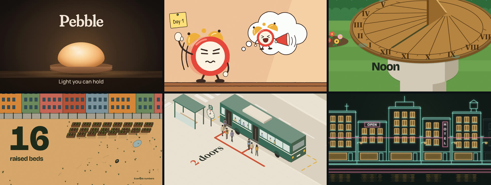</p>
<p align="center"><sub>Phim mẫu làm bằng app, mỗi phim một film style.</sub></p>

> **Trạng thái: bản xem trước.** App còn thay đổi nhanh, có thể còn chỗ chưa mượt.

## Mới trong 0.8.214.7

- **Thumbnails:** chọn một khung hình của phim; Claude dàn thành ảnh bìa 16:9 hoặc 9:16, tự do hoặc theo Brand Kit của bạn.
- **Một phim, nhiều khổ:** Adaptation làm thêm khổ 9:16, 1:1 và các khổ khác; mỗi khổ render với bản mix của chính phim.
- **Casting:** thêm bốn cách tạo nhân vật, một tờ nhân vật duy nhất, thêm nhân vật có sẵn, và ngăn Characters trong Film Editor.
- **Phụ đề** lưu thành file .srt và .vtt cạnh bản render.
- **Âm thanh:** đỉnh giọng đọc giữ ở −1 dBTP; Version 1 nghe đúng như bản xuất.
- **After Effects:** mức âm và tắt tiếng của từng làn được giữ, nền của phim thành một layer.

Danh sách đầy đủ ở [CHANGELOG](CHANGELOG.md).

## Một phim được làm thế nào

<p align="center">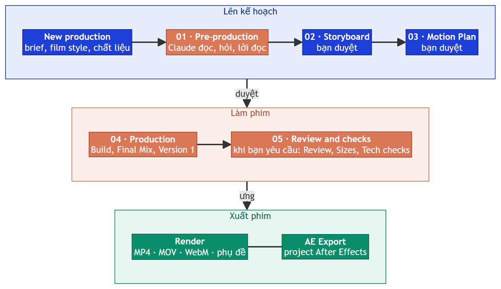</p>

| Bước | Việc gì diễn ra |
|---|---|
| **New production** | Tên phim, film style, khổ và độ dài, Brand Kit, nhân vật, brief và chất liệu (thiết kế, PSD, deck, ảnh, nhạc, kịch bản) |
| **01 · Pre-production** | Claude đọc hết và dừng lại hỏi khi brief và style mâu thuẫn. Lời đọc làm ở bước này (ElevenLabs, hoặc giọng Kokoro miễn phí) và được canh giờ từng chữ |
| **02 · Storyboard** | Bảng vẽ từng shot, kèm lý do của mỗi shot. Bạn duyệt hoặc góp ý |
| **03 · Motion Plan** | Chuyển động của từng shot bằng số: thời điểm, quãng đường, easing, điểm âm thanh. Bạn duyệt và dựng |
| **04 · Production** | Phim được dựng bằng code từng shot, rồi nhạc và hiệu ứng âm thanh được mix (Standard −14 LUFS, hoặc Quieter −16 LUFS). Bạn xem **Version 1** |
| **05 · Review and checks** | Chỉ khi bạn yêu cầu: Claude xem phim của mình, chấm trên 10 và sửa; **Sizes** thêm khổ khác; **Tech checks** báo độ tương phản, chữ chồng, hình đứng yên và âm thanh bằng lời dễ hiểu |
| **Render · AE Export** | MP4, MOV hoặc WebM, có phụ đề nếu bạn muốn, hoặc một project After Effects |

Trong **Film Editor**, phim chạy từng khung hình đúng như khi render. Bấm vào chữ bất kỳ trên khung hình để sửa, hoặc bấm **Pin a note**
(N) rồi chấm một điểm trên hình: ghi chú tới Claude kèm thời điểm, shot và vị trí. Timeline chứa lời đọc, hiệu ứng và nhạc; kéo là nghe
mức âm thay đổi ngay.

<p align="center">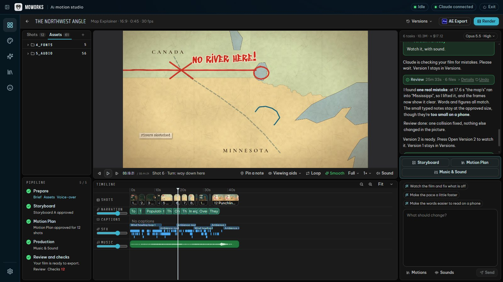<br><sub>Film Editor (The Desk)</sub></p>

**After Effects.** Mỗi film style có một nhãn, đo trên phim mẫu của style đó:

| Nhãn | After Effects nhận được gì | Số style |
|---|---|---|
| **AE editable** | Chữ và hình khối thành layer sửa được | 6 |
| **AE partly editable** | Một phần thành layer, phần còn lại là video | 93 |
| **AE video only** | Cả phim là một layer video | 10 |
| **AE not checked yet** | Chưa đo: vẫn xuất được, nhưng chưa biết trước kết quả | 24 |

## Tính năng

| Trang | Làm gì |
|---|---|
| **Productions** | Các phim của bạn, mới nhất trước; mỗi phim mở trong Film Editor. **New production** để bắt đầu phim mới |
| **Writers' Room** | **Research** đề xuất ý tưởng theo đúng cách của một film style, có nguồn đã kiểm; **Pitches** giữ ý tưởng của bạn và các mẫu; **Scripts** viết kịch bản từng cảnh và mở phim mới từ đó |
| **Film Styles** | 133 style theo tác giả, mỗi style có phim mẫu, ghi công và nhãn AE |
| **Casting** | Nhân vật diễn trong phim của bạn, đứng đúng chiều cao. Claude tạo nhân vật từ brief theo nét vẽ của phim (hand-drawn, Brush cartoon, 3D Cartoon, What If, 2D Explainer, Stickman Explainer, Ricks Clip…), hoặc dùng một trong 34 nhân vật có sẵn |
| **Brand Kits** | Màu, font, logo và thành phần của một thương hiệu, áp cho cả phim. 13 frame preset của HyperFrames có sẵn; tự làm Brand Kit từ thư mục thương hiệu (PDF, PowerPoint, ảnh, font, AI, PSD, ZIP) |
| **Motion Library** | 889 motion, 454 block và thành phần, 192 thuật ngữ chuyển động, mỗi mục có xem trước, xếp theo loại và nhóm |
| **Thumbnails** | Ảnh bìa cho phim ở 16:9 và 9:16, từ khung hình bạn chọn |
| **Studio Settings** | Tài khoản và model Claude, thư mục phim, giao diện, render, lời đọc, thành phần, cập nhật |

Hai giao diện, cùng tính năng, chọn ở lần mở đầu (đổi ở Studio Settings › General › Appearance): **The Desk**, không gian tối có thanh
điều hướng bên trái, và **The Studio**, xưởng bàn đèn với giấy, bảng ghim và storyboard ghim trên bảng.

<table>
<tr>
<td width="50%" valign="top">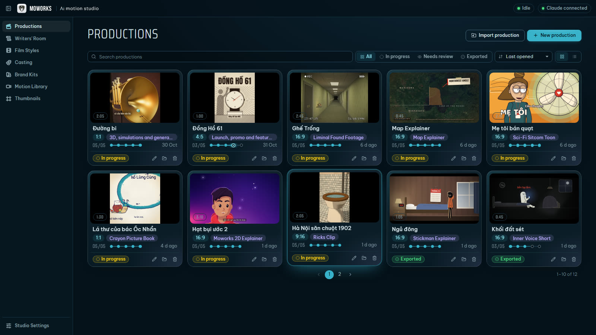<br><sub>Productions · The Desk</sub></td>
<td width="50%" valign="top">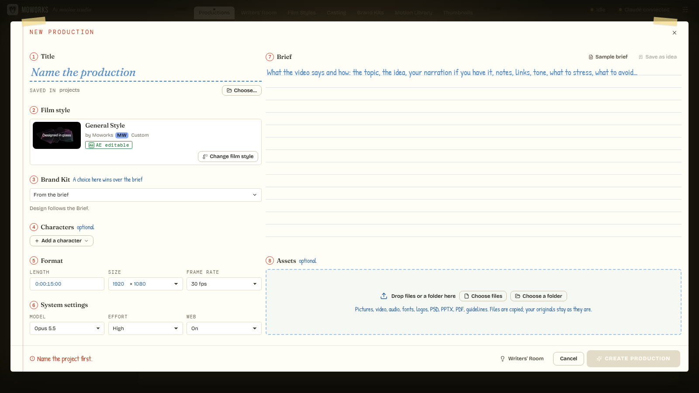<br><sub>New production · The Studio</sub></td>
</tr>
<tr>
<td width="50%" valign="top">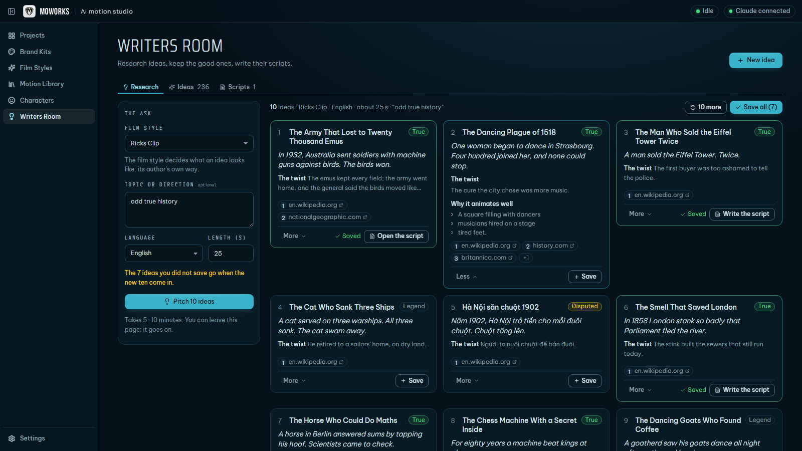<br><sub>Writers' Room · The Desk</sub></td>
<td width="50%" valign="top">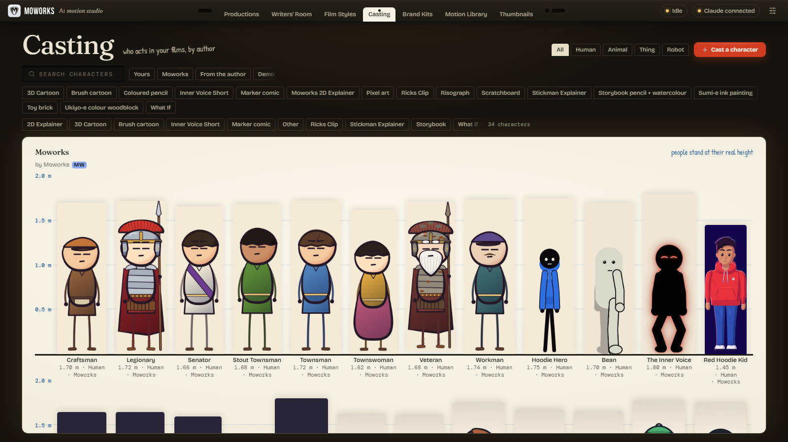<br><sub>Casting · The Studio</sub></td>
</tr>
<tr>
<td width="50%" valign="top">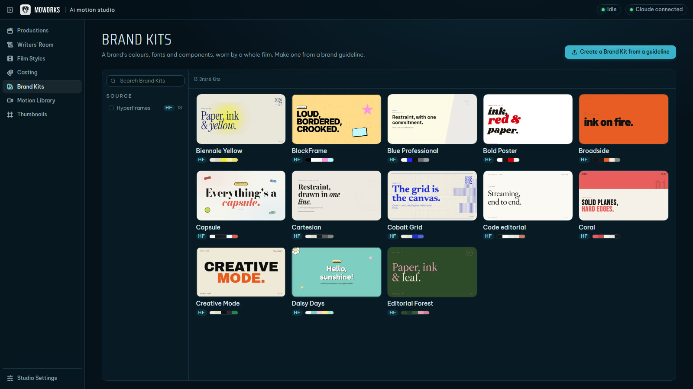<br><sub>Brand Kits · The Desk</sub></td>
<td width="50%" valign="top">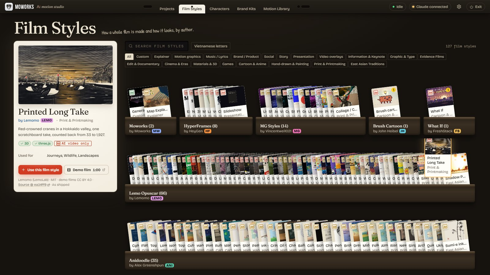<br><sub>Film Styles · The Studio</sub></td>
</tr>
<tr>
<td width="50%" valign="top">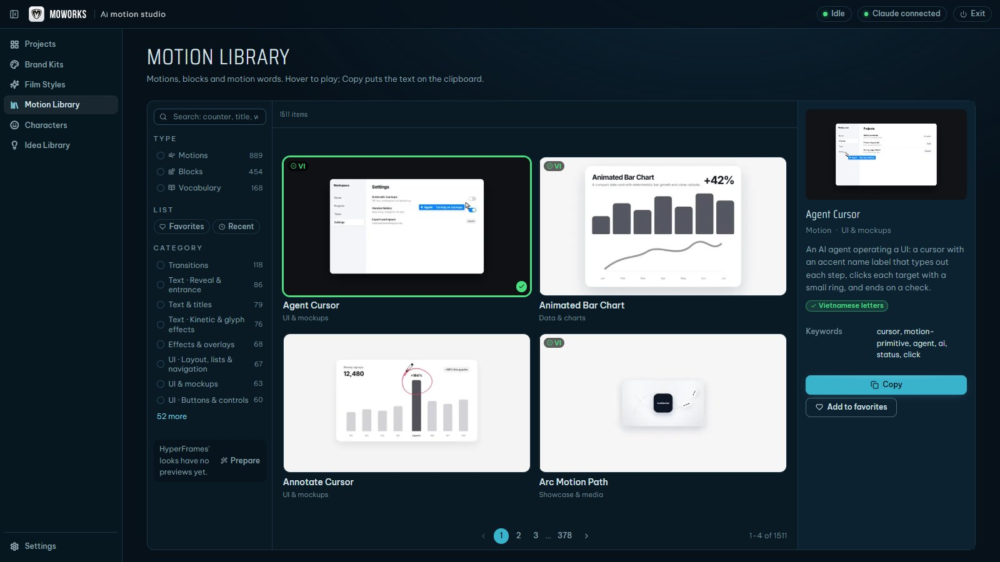<br><sub>Motion Library · The Desk</sub></td>
<td width="50%" valign="top">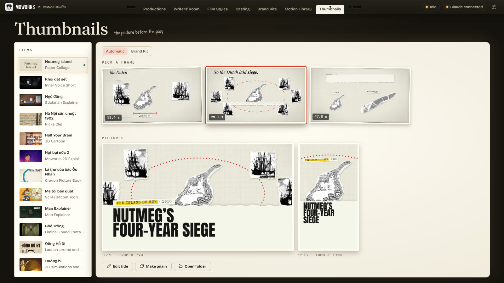<br><sub>Thumbnails · The Studio</sub></td>
</tr>
</table>

<details>
<summary>Các trang này ở giao diện còn lại</summary>

<table>
<tr>
<td width="50%" valign="top">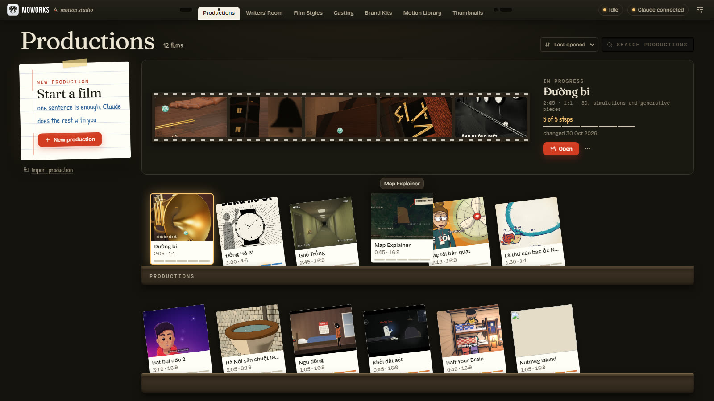<br><sub>Productions · The Studio</sub></td>
<td width="50%" valign="top">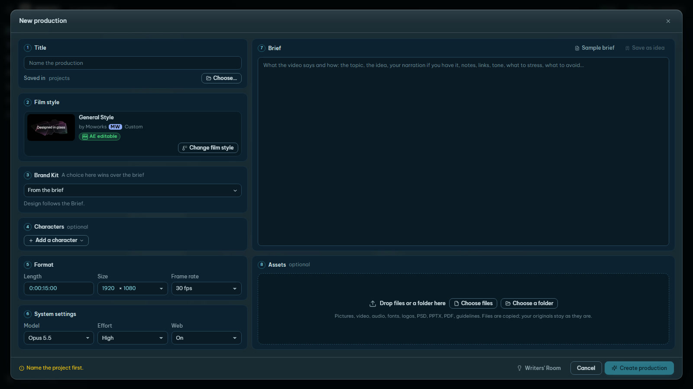<br><sub>New production · The Desk</sub></td>
</tr>
<tr>
<td width="50%" valign="top">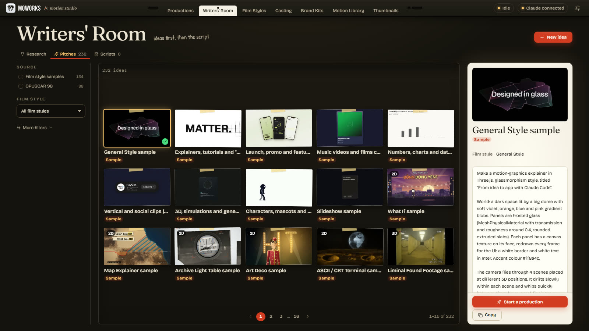<br><sub>Writers' Room · The Studio</sub></td>
<td width="50%" valign="top">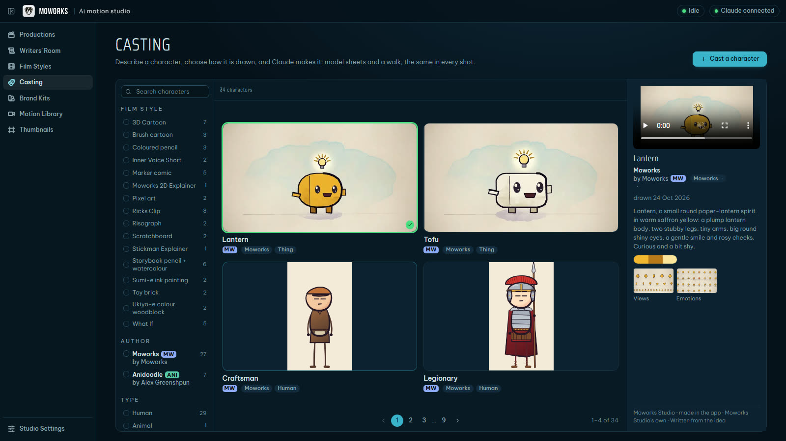<br><sub>Casting · The Desk</sub></td>
</tr>
<tr>
<td width="50%" valign="top">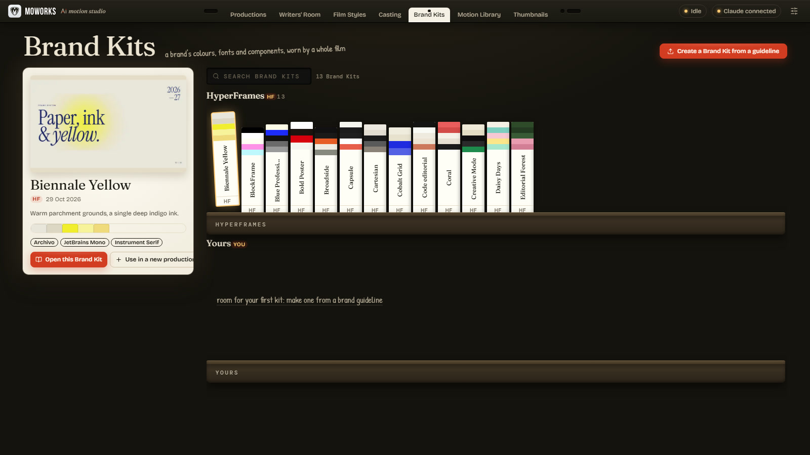<br><sub>Brand Kits · The Studio</sub></td>
<td width="50%" valign="top">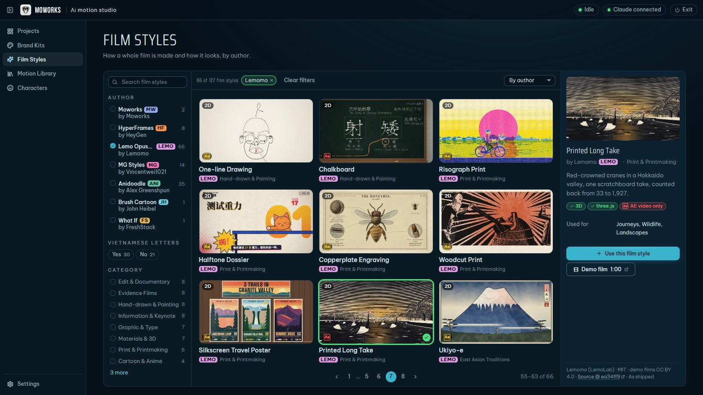<br><sub>Film Styles · The Desk</sub></td>
</tr>
<tr>
<td width="50%" valign="top">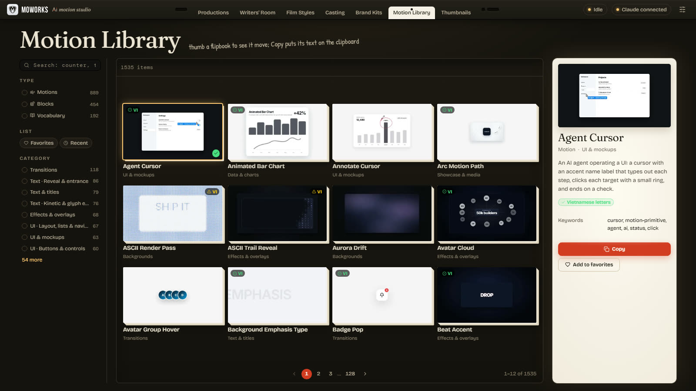<br><sub>Motion Library · The Studio</sub></td>
<td width="50%" valign="top">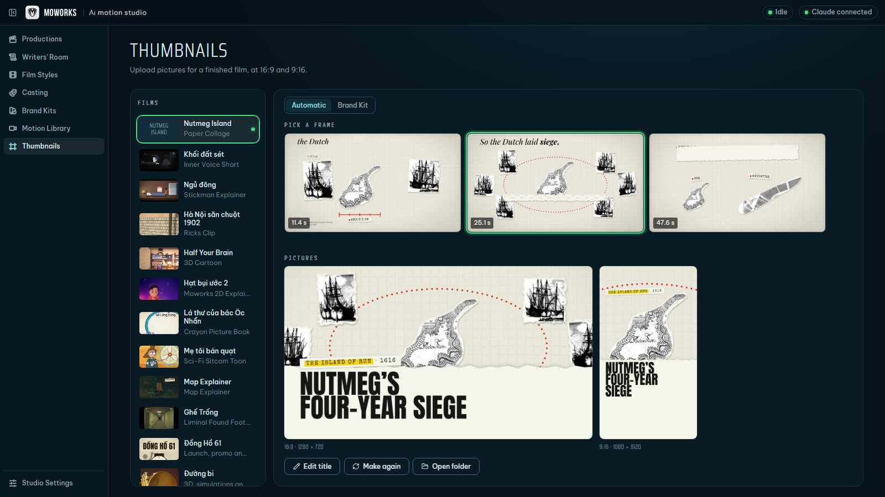<br><sub>Thumbnails · The Desk</sub></td>
</tr>
<tr>
<td width="50%" valign="top">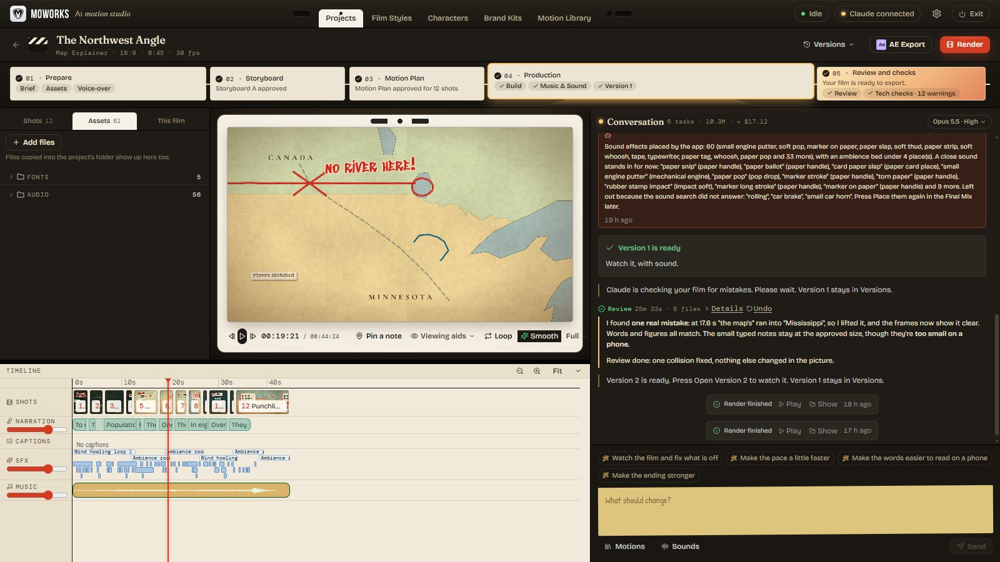<br><sub>Film Editor · The Studio</sub></td>
<td width="50%" valign="top"></td>
</tr>
</table>
</details>

**Nhân vật có sẵn trong app (34):** Mira, Theo, Bit, chú báo, Bơ, Firefighter và Grandma (vẽ tay, Anidoodle); Mika, Ravi, June, Otto,
Bea, Leo và Noor (3D Cartoon); Pip, Mo, Sis, Mum và Suit (What If); tám người La Mã của Ricks Clip; Hoodie Hero (Stickman Explainer);
nhân vật chính và cái bóng của anh (Inner Voice Short); Red Hoodie Kid (2D Explainer); và các nhân vật mẫu Clawd, Lantern và Tofu.
Chúng nằm trong thư mục riêng của app, nên một bản cập nhật không bao giờ trộn lẫn với nhân vật bạn tự tạo.

**Sizes.** Một phim có thể có nhiều khổ: bản gốc (ví dụ 16:9) cộng thêm 9:16, 1:1 hoặc 4:5, mỗi khổ được dàn lại cho vừa khung và
render với bản mix của chính phim.

<p align="center">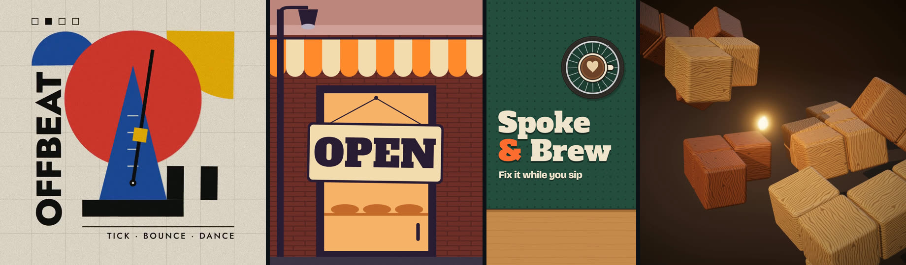<br><sub>1:1 · 4:5 · 9:16 · 1:1</sub></p>

## Film style

Film style quyết định toàn bộ diện mạo và các luật Claude tuân theo. File style của bên thứ ba được dùng đúng như tác giả phát hành,
ghim ở một commit; mỗi thẻ trong Film Styles ghi tác giả, giấy phép và nguồn.

| Bộ | Tác giả | Style | Giấy phép | Nguồn |
|---|---|---|---|---|
| **Moworks** | Moworks | 3: **General Style**; **Map Explainer** (bản đồ giấy và mặt đất thật dưới một camera liền mạch); **Brush cartoon** (hoạt hình nét cọ do chính nhân vật của dự án diễn) | sản phẩm của app. Dữ liệu bản đồ [Natural Earth](https://www.naturalearthdata.com), [world-atlas](https://github.com/topojson/world-atlas/tree/v2.0.2), ảnh vệ tinh [EOX](https://cloudless.eox.at) (CC BY 4.0). Brush cartoon dựng trên ClaudeAnimationBase của John Heibel (MIT; p5.js LGPL-2.1, p5.brush MIT) | làm cho app; Brush cartoon từ [JohnHeibel/ClaudeAnimationBase @ `0ac8bf2`](https://github.com/JohnHeibel/ClaudeAnimationBase/tree/0ac8bf2b31942376cb6b8c4074715595d512acd2) |
| **Moworks film styles** | Moworks Studio | 7: Paper Collage, Stickman Explainer, Inner Voice Short, 3D Cartoon, Moworks 2D Explainer, Ricks Clip, What If (trên engine MIT của FreshStack) | sản phẩm của app | skill gốc của app; phần bên ngoài ở [THIRD-PARTY.md](THIRD-PARTY.md) |
| **HyperFrames** | HeyGen | 8: Slideshow, Explainer, Launch, Music video, Data, Vertical, 3D, Character | Apache-2.0 | [heygen-com/hyperframes @ `4719543`](https://github.com/heygen-com/hyperframes/tree/4719543e972548a261b8354f0a8dada479ae5d93/skills) (v0.8.214) |
| **Lemo-Opuscar** | Lemomo (LemoLab) | 66 style dựng bằng code (các thời kỳ điện ảnh, tài liệu, editorial, dữ liệu…; Memphis Diorama của EianLu) | MIT; ảnh mẫu CC BY 4.0 | [lemomo-ai/lemo-opuscar @ `bebbbe1`](https://github.com/lemomo-ai/lemo-opuscar/tree/bebbbe1aa92a3cb4bb6f83500e61b23a17d1aa00) |
| **mg-styles-15** | Vincentwei1021 | 14 style motion design (style 3D dựng bằng Blender không đưa vào) | MIT | [Vincentwei1021/mg-styles-15 @ `49052d8`](https://github.com/Vincentwei1021/mg-styles-15/tree/49052d80bfaf9fa8412cc9710530e5e95a3b8d8c) |
| **Anidoodle** | Alex Greenshpun (10x Company) | 35 chất liệu vẽ tay (32 chất liệu + 3 house style) | Apache-2.0 kèm NOTICE | [alexgreensh/anidoodle @ `4ae27d2`](https://github.com/alexgreensh/anidoodle/tree/4ae27d2c281fcfd01bce87ab13dc5ad4df81a795) (v0.10.1) |

Mọi style còn theo hai luật chung của app: **phim luôn sống** (không khung hình nào đứng yên quá hai giây) và **dừng lại hỏi** (mâu thuẫn
hay thiếu chất liệu là câu hỏi cho bạn, không bao giờ tự đoán).

### Làm bằng app

<table>
<tr>
<td width="33%" valign="top">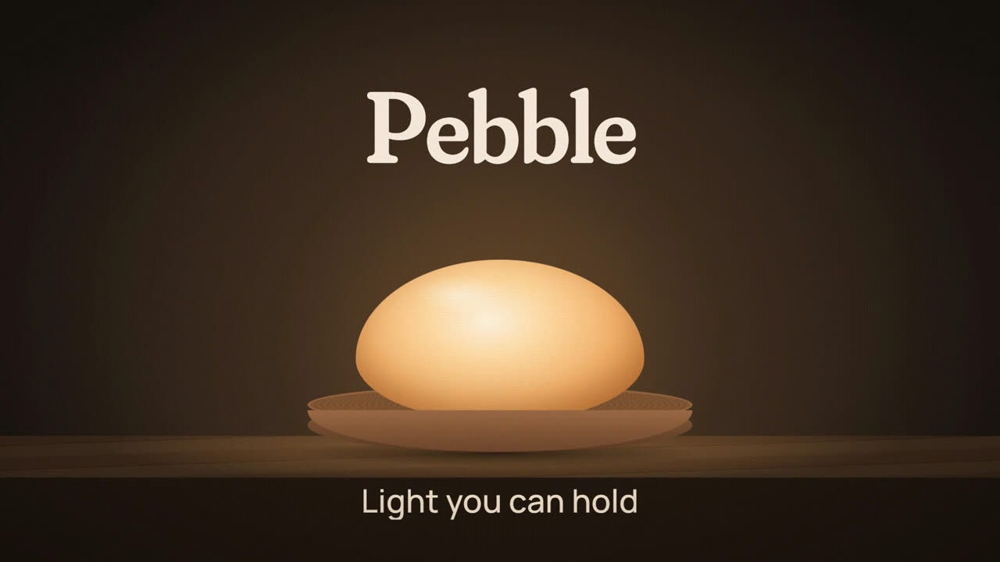<br><sub><b>Pebble, ra mắt chiếc đèn</b> · Launch · HeyGen</sub></td>
<td width="33%" valign="top">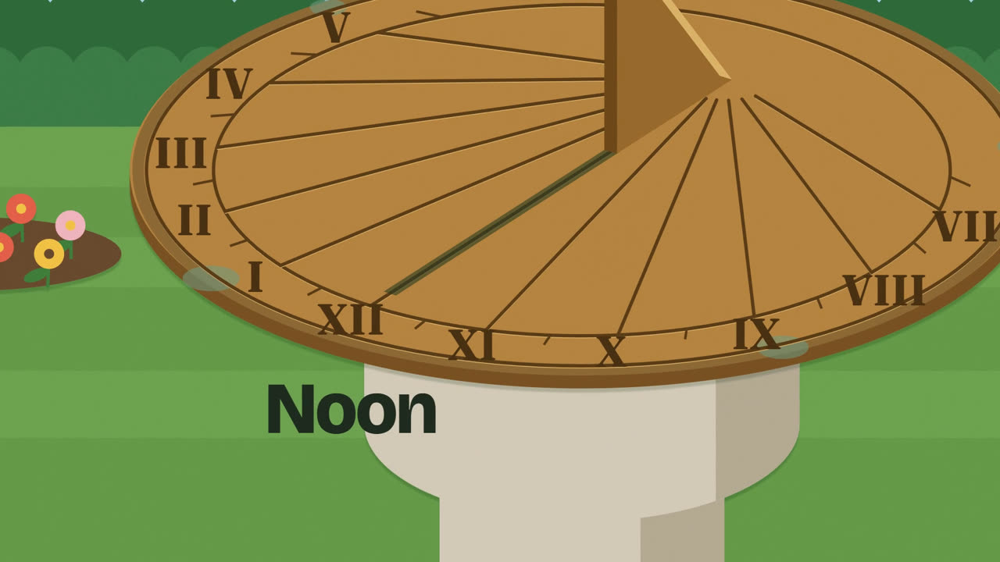<br><sub><b>Đồng hồ mặt trời hoạt động thế nào</b> · Explainer · HeyGen</sub></td>
<td width="33%" valign="top">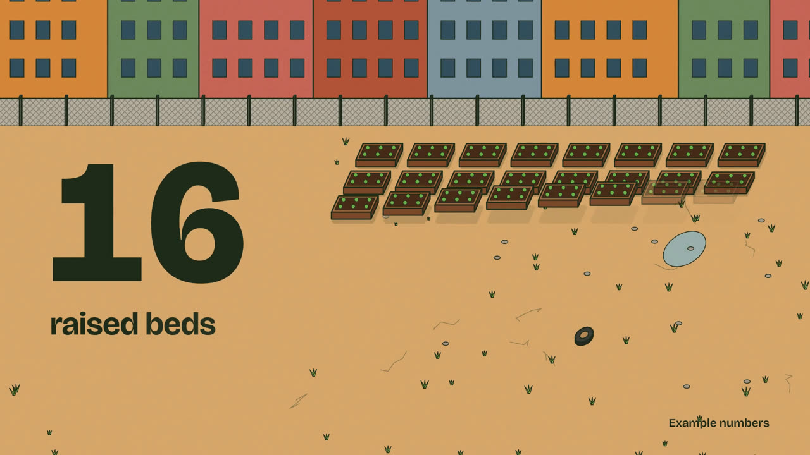<br><sub><b>Khu vườn cộng đồng qua những con số</b> · Data · HeyGen</sub></td>
</tr>
<tr>
<td width="33%" valign="top">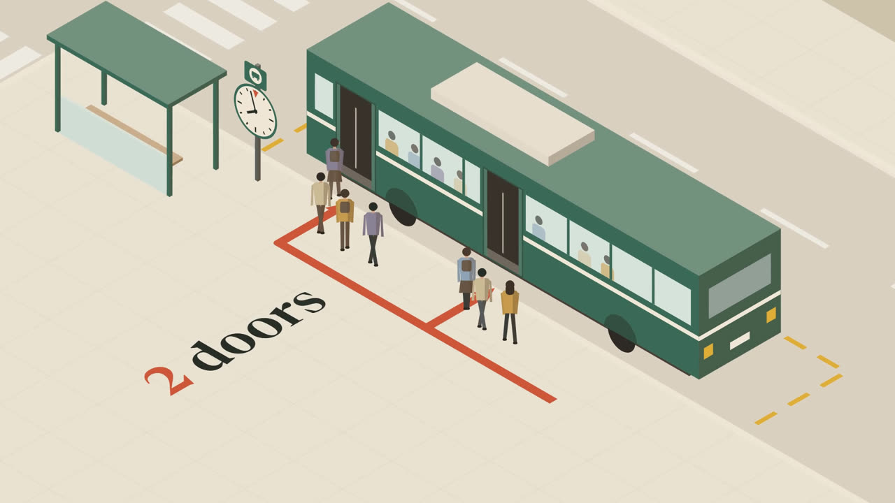<br><sub><b>Hai cửa trên xe buýt</b> · Isometric Picture Book · Lemomo</sub></td>
<td width="33%" valign="top">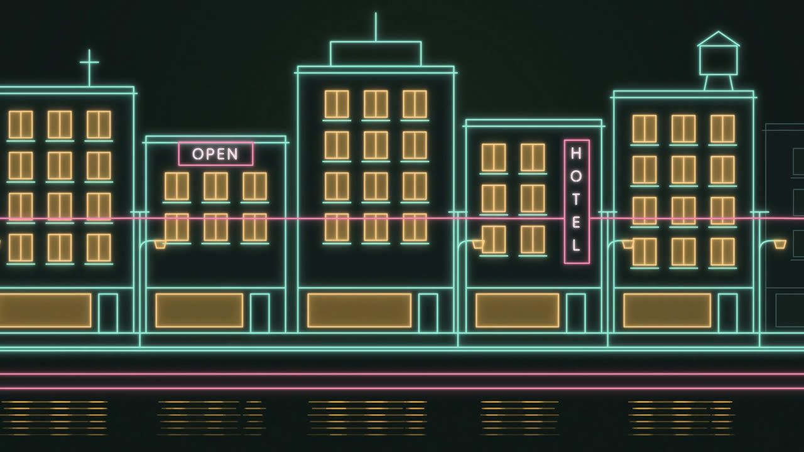<br><sub><b>Thành phố sáng theo nhịp</b> · Music video · HeyGen</sub></td>
<td width="33%" valign="top">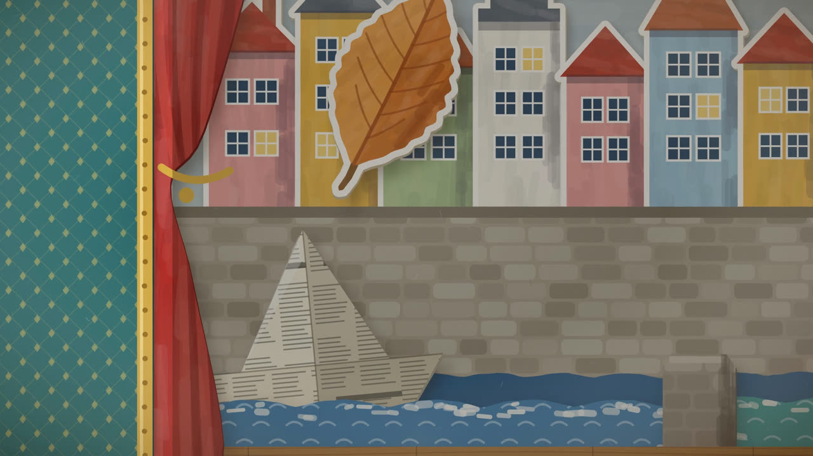<br><sub><b>Thị trấn sân khấu giấy</b> · Toy-theatre paper collage · Alex Greenshpun</sub></td>
</tr>
<tr>
<td width="33%" valign="top">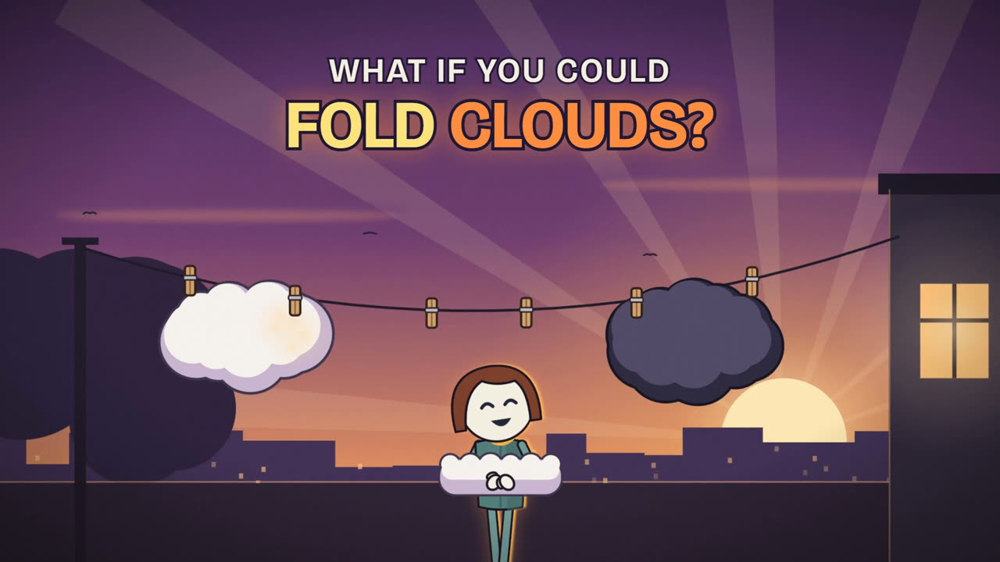<br><sub><b>Nếu gấp được mây thì sao?</b> · What If · Moworks Studio</sub></td>
<td width="33%" valign="top">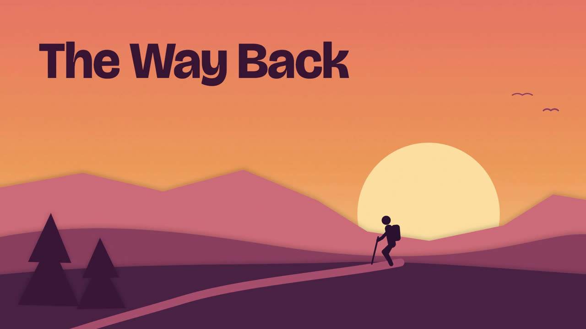<br><sub><b>Một ngày leo núi</b> · Slideshow · HeyGen</sub></td>
<td width="33%" valign="top"><br><sub><b>Khối rubik tách rời</b> · 3D · HeyGen</sub></td>
</tr>
<tr>
<td width="33%" valign="top">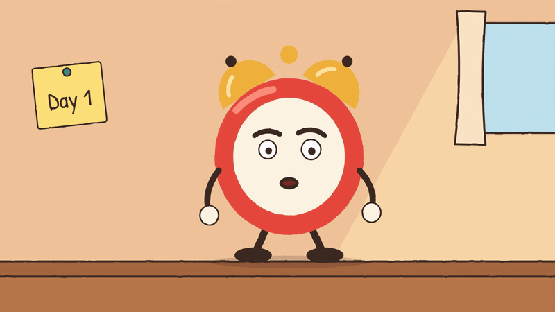<br><sub><b>Ngày đầu của đồng hồ báo thức</b> · Character · HeyGen</sub></td>
<td width="33%" valign="top">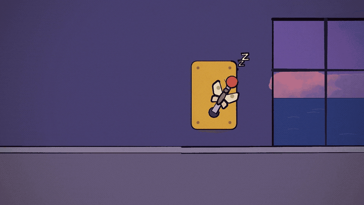<br><sub><b>Chú mèo hải đăng</b> · Brush cartoon · Moworks</sub></td>
<td width="33%" valign="top"></td>
</tr>
</table>

## Yêu cầu

| | |
|---|---|
| **Hệ thống** | Windows 10 hoặc 11, 64-bit; vài GB trống, cộng chỗ cho phim của bạn |
| **Cần có trước** | [Git for Windows](https://git-scm.com/download/win), [Node.js](https://nodejs.org) 22 trở lên, và Claude Code (có sẵn trong app Claude desktop) với tài khoản Claude có Claude Code |
| **App tự cài** | HyperFrames 0.8.214 và Chrome của nó, Python 3.12, FFmpeg 9.0, các thành phần Python và model chuyển giọng nói thành chữ (Whisper turbo): tổng khoảng 2,6 GB |
| *Tuỳ chọn* | Key ElevenLabs cho lời đọc (hoặc giọng Kokoro miễn phí, khoảng 375 MB, không có tiếng Việt) · After Effects cho AE Export · card NVIDIA (4 GB trở lên) để canh giờ lời đọc nhanh hơn |

## Bắt đầu nhanh

1. Cài Git, Node.js 22+ và Claude Code.
2. Clone vào thư mục `app` nằm trong một thư mục riêng, trên ổ đĩa của máy (không dùng Google Drive, OneDrive hay Dropbox: đồng bộ khoá file khi phim đang render):
   ```bash
   git clone https://github.com/moworksstudio/moworks-studio "Moworks Studio\app"
   ```
3. Bấm đúp `Moworks Studio\app\Moworks Studio.bat`. Lần đầu app cài các gói của nó (khoảng 80 MB) rồi mở cửa sổ.
4. Trong app: chọn giao diện, rồi **Set up Moworks Studio**: chọn thư mục chứa phim và bấm **Install**. Bấm chip Claude trên thanh trên
   cùng để đăng nhập (đăng nhập của chính Claude Code; app không bao giờ thấy mật khẩu của bạn).
5. *Tuỳ chọn:* thêm key ElevenLabs ở Studio Settings › System › Voice-over. Rồi **Productions › New production**.

Dữ liệu của bạn nằm cạnh app: `projects\` (phim), `library\` (Brand Kit, nhân vật bạn tạo), `models\` (khi đã cài Whisper).

### Hoặc để Claude cài

Dán câu này vào Claude Code:

> Install Moworks Studio from https://github.com/moworksstudio/moworks-studio: clone it and follow its .claude/CLAUDE.md.

Claude kiểm Git, Node.js và Claude Code (hỏi trước khi cài thứ còn thiếu), clone app và mở nó; màn hình lần đầu lo phần còn lại.

## Cập nhật

Studio Settings › Update đưa app lên bản mới nhất: tải về, cài lại gói nếu cần, build lại, kiểm app mở được rồi khởi động lại. Nếu một
bước hỏng, app quay về đúng bản cũ. Phim, thư viện, cài đặt và key của bạn không bao giờ bị đụng tới.

## Gỡ cài đặt

Studio Settings › Update › **Uninstall Moworks Studio…** chuyển app vào Thùng rác, và chỉ khi bạn đánh dấu: các model đã tải, phim và
thư viện của bạn. Git, Node.js, Python, FFmpeg và Claude Code được giữ lại. Nếu app không mở được, chạy `tools\uninstall.bat` trong thư
mục app (thêm `--models` hoặc `--films` để xoá cả những thứ đó).

## Xử lý sự cố

| Sự cố | Cách xử lý |
|---|---|
| "Node.js was not found" | Cài Node.js 22 trở lên rồi mở lại `Moworks Studio.bat` |
| Lần đầu mở dừng lại khi đang cài | Kiểm tra mạng rồi chạy lại file .bat; các dòng phía trên cho biết bước nào hỏng |
| "Claude is not connected" | Bấm chip Claude trên thanh trên cùng và đăng nhập |
| Thiếu một thành phần | Studio Settings › System cho biết trạng thái từng thành phần và bước tiếp theo |
| "The local service is not running" | Mở lại `Moworks Studio.bat` |
| Không tạo được lời đọc | Kiểm key ElevenLabs ở Studio Settings › System › Voice-over (key cần quyền text-to-speech) |
| AE Export lỗi | Mở After Effects, đóng mọi hộp thoại trong đó rồi xuất lại; thông báo nêu bước bị hỏng |

Giới hạn đã biết: [KNOWN-ISSUES.md](KNOWN-ISSUES.md).

## Quyền riêng tư

- **Trên máy bạn.** Brief, chất liệu và phim nằm trong thư mục phim của bạn; Claude đọc chúng qua Claude Code để làm việc, ngoài ra không gì tải chúng lên.
- **Key** (ElevenLabs) được mã hoá theo tài khoản Windows của bạn và không bao giờ vào log, file dự án hay tiến trình render.
- **Claude** chạy bằng tài khoản của chính bạn; app không bao giờ cầm mật khẩu của bạn.
- **Không thu thập dữ liệu sử dụng.** App chỉ lên mạng cho các dịch vụ bạn dùng: Claude, dịch vụ giọng đọc, nhạc và hiệu ứng âm thanh
  (Mixkit, Openverse), ảnh vệ tinh cho Map Explainer (EOX) và tải các thành phần.

## Ghi công và giấy phép

Render bằng engine mã nguồn mở [HyperFrames](https://github.com/heygen-com/hyperframes) (HeyGen, Apache-2.0), ghim ở 0.8.214 và dùng
nguyên bản. Moworks Studio phát triển từ [Moworks Motion](https://github.com/moworksstudio/moworks-motion), bộ công cụ motion trước đây
của Moworks cho Claude Code. Mọi nguồn đi kèm hoặc tải về, với tác giả, đường dẫn đúng commit và giấy phép, có trong
[THIRD-PARTY.md](THIRD-PARTY.md). Mỗi phiên bản có gì: [CHANGELOG.md](CHANGELOG.md).

Miễn phí cho mục đích cá nhân, phi thương mại; không phân phối lại, bán hay chia sẻ, kể cả bản đã sửa ([LICENSE](LICENSE)).
© 2026 Moworks. Thành phần bên thứ ba giữ giấy phép riêng, liệt kê trong [THIRD-PARTY.md](THIRD-PARTY.md); giấy phép này không giới hạn
chúng.
