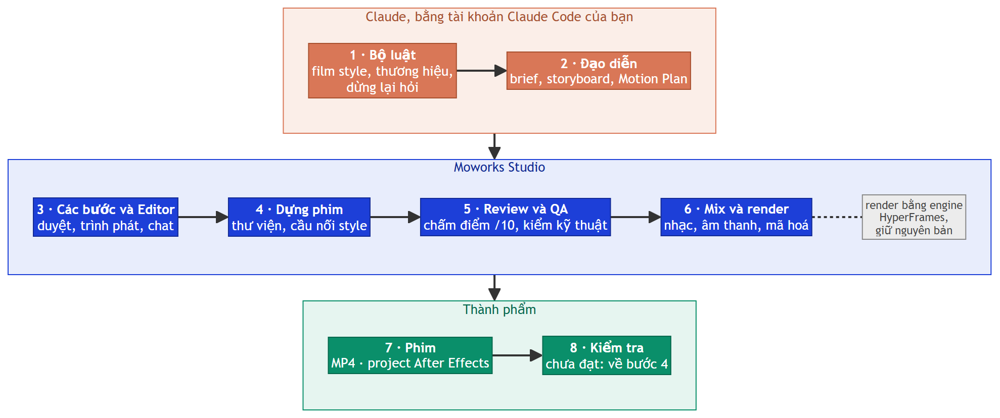
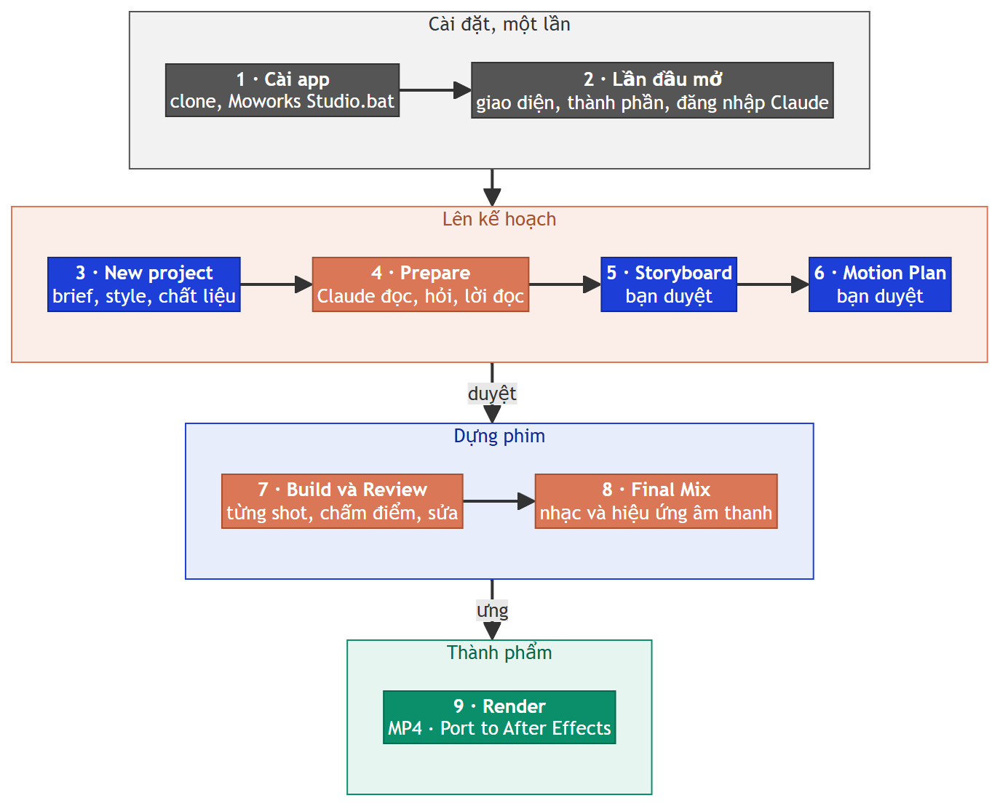

<h1 align="center">Moworks Studio</h1>

<p align="center"><a href="README.md">English</a> · <b>Tiếng Việt</b></p>

<p align="center"><b>Xưởng làm phim motion trên máy tính: Claude đạo diễn, Moworks Studio dựng và kiểm từng khung hình, bạn duyệt từng bước.</b></p>

<p align="center">
  
  
  
  
  
  
</p>

<p align="center">
  <a href="#bắt-đầu-nhanh">Bắt đầu nhanh</a> ·
  <a href="#cách-app-hoạt-động">Cách hoạt động</a> ·
  <a href="#một-phim-được-làm-thế-nào">Quy trình</a> ·
  <a href="#film-style">Film style</a> ·
  <a href="#làm-thử-một-phim">Làm thử</a> ·
  <a href="#xử-lý-sự-cố">Xử lý sự cố</a> ·
  <a href="CHANGELOG.md">Thay đổi</a> ·
  <a href="KNOWN-ISSUES.md">Giới hạn đã biết</a> ·
  <a href="THIRD-PARTY.md">Bên thứ ba</a>
</p>

<p align="center"></p>
<p align="center"><sub>Phim mẫu làm bằng app. Hàng trên: ra mắt chiếc đèn (Launch · style của HeyGen) · đồng hồ báo thức (Character · style của HeyGen) · đồng hồ mặt trời (Explainer · style của HeyGen).<br>Hàng dưới: khu vườn qua những con số (Data · style của HeyGen) · trạm xe buýt (Isometric Picture Book · style của Lemomo) · thành phố neon (Music video · style của HeyGen). Xem thêm ở <a href="#làm-bằng-app">Làm bằng app</a>.</sub></p>

Moworks Studio là ứng dụng máy tính để làm phim motion graphic cùng Claude. Bạn viết brief, đưa chất liệu (thiết kế, PSD, deck, ảnh,
nhạc, kịch bản lời đọc) và chọn một trong 126 film style. Claude lên kế hoạch cho phim, vẽ storyboard để bạn duyệt và viết Motion Plan
bằng số liệu; sau đó app dựng phim từng shot bằng code, tự review và chấm điểm, trộn nhạc và hiệu ứng âm thanh, kiểm tra kỹ thuật và xuất
phim ra MP4, MOV hoặc WebM. Phim ở phần lớn các style còn xuất được sang After Effects thành layer chỉnh sửa được.

**Sửa phim ngay trên khung hình.** Trong Editor, bấm vào chữ bất kỳ trên khung hình để sửa tại chỗ, cả font, cỡ chữ và màu (mỗi lần sửa
là một bước có thể hoàn tác). Hoặc bấm **Pin a note** (N), chấm một điểm hay kéo một khung trên hình rồi ghi cần sửa gì ở đó: ghi chú
gửi tới Claude kèm đúng thời điểm, shot và vị trí trên hình.

Mỗi bước dừng lại chờ bạn ở chỗ cần thiết: bạn duyệt storyboard và Motion Plan, theo dõi phim được dựng ngay trong Editor, và nhờ sửa bằng
lời. App chạy trên máy của bạn và điều khiển Claude Code bằng tài khoản Claude của chính bạn; dự án, key và tài liệu của khách hàng nằm lại
trên máy.

> **Trạng thái: bản xem trước riêng tư.** Repo này chỉ chia sẻ với người được mời. Vui lòng không phát tán lại.

## Cách app hoạt động

<p align="center"></p>

Màu: cam = Claude · xanh dương = Moworks Studio · xanh lá = thành phẩm · xám = engine render mã nguồn mở.

Claude đạo diễn: theo bộ luật của film style và thương hiệu của bạn, và dừng lại hỏi khi có mâu thuẫn. Moworks Studio làm phần còn lại:
chạy các bước và việc duyệt, dựng từng shot với thư viện chuyển động và cầu nối style, review và chấm điểm phim, trộn âm thanh và render.
Phần render dùng engine mã nguồn mở HyperFrames, nguyên như bản phát hành.

## Vì sao dựng phim bằng code

- **Tất định:** mỗi khung hình là một hàm của thời gian. Cùng một dự án luôn cho cùng các khung hình, dù render bao nhiêu lần.
- **Sửa cục bộ:** thay một shot, một dòng chữ hay một nhịp mà không ảnh hưởng phần còn lại.
- **Sửa bằng lời:** "chuyển cảnh nhanh hơn", "đổi nhạc", "tiêu đề vào đúng phách mạnh" là những thay đổi Claude làm trong vài phút, ngay
  trong dự án đó.
- **Duyệt được ở mọi bước:** brief, storyboard và Motion Plan là các file bạn đọc và duyệt trước khi chuyển động được dựng.

## Một phim được làm thế nào

Mọi film style đi theo cùng một quy trình. Mỗi bước để lại một file trong dự án; bước sau chỉ chạy khi bước trước đã xong hoặc được bạn
bỏ qua.

<p align="center"></p>

Màu: xám = cài đặt · cam = Claude và app thực hiện · xanh dương = bạn viết, chọn hoặc duyệt · xanh lá = thành phẩm.

| Bước | Việc diễn ra | Bạn |
|---|---|---|
| **Brief** | New project: tiêu đề, film style, Brand Kit, nhân vật, định dạng (khổ hình, số khung hình mỗi giây, độ dài), model Claude và mức effort, brief và chất liệu của bạn | viết và chọn |
| **Prepare** | Claude đọc brief và chất liệu, viết `BRIEF.md`. Khi brief và style mâu thuẫn (style phim câm mà có lời đọc, khổ 4:3 so với 4:5…), Claude dừng lại hỏi, kèm các phương án và đề xuất | trả lời |
| **Lời đọc** *(tuỳ chọn)* | ElevenLabs (hoặc Fish Audio) đọc kịch bản; Whisper canh thời gian từng chữ để shot rơi đúng lời (tải thêm tuỳ chọn, app đề xuất ở lần đầu) | chọn giọng |
| **Storyboard** | Một phương án storyboard vẽ thành bảng, từng shot, ghi lý do của từng shot (thêm phương án khi bạn yêu cầu) | duyệt hoặc góp ý |
| **Motion Plan** | Chuyển động của từng shot bằng số: thời điểm, quãng đường, ease, mốc âm thanh. Hộp duyệt cho biết thời gian dựng và lượng dùng Claude ước tính | duyệt và dựng |
| **Build** | Claude dựng phim bằng code, từng shot; mỗi shot được lint và kiểm tra ngay khi xong | theo dõi |
| **Review** | Claude tự xem phim của mình, chấm điểm trên 10 và sửa những gì tìm thấy, qua nhiều vòng | đọc điểm |
| **Final Mix** | Nhạc (3 bài miễn phí từ Mixkit để chọn, hoặc nhạc của bạn) và hiệu ứng âm thanh đặt theo hình, trộn về −16 LUFS | chọn |
| **Tech checks** | Kiểm độ tương phản, chữ chồng nhau, khung đứng hình, âm lượng và file, báo bằng lời dễ hiểu | đọc |
| **Render** | MP4 (H.264: Standard cho web và mạng xã hội, hoặc High), MOV (QuickTime) hoặc WebM, kèm một bản Smooth để phát mượt trong Editor | render |
| **After Effects** | **Port to After Effects** dựng project AE với text layer và shape layer thật ở những style cho phép | port |

**Editor** phát phim đúng từng khung hình như khi render: danh sách shot và quy trình ở bên trái, timeline dưới khung hình, Claude ở
cột chat bên phải. Bấm vào một phần tử trong phim để Claude nhắm vào nó, hoặc tự sửa chữ của nó bằng tay.

<p align="center"><br><sub>Editor (The Desk): shot và quy trình bên trái, phim trong trình phát, timeline, và Claude thuật lại từng bước bên phải</sub></p>

### Huy hiệu After Effects

Mỗi film style có một huy hiệu, đo trên một phim mẫu của style đó:

| Huy hiệu | After Effects nhận được gì |
|---|---|
| **AE editable** | Chữ và hình khối thành layer chỉnh sửa được |
| **AE partly editable** | Một phần thành layer, phần còn lại thành video |
| **AE video only** | Cả phim là một layer video |

### Hai giao diện

App có hai giao diện đầy đủ, tính năng như nhau; lần mở đầu tiên app hỏi bạn chọn giao diện nào, sau đó đổi ở Settings › General ›
Appearance.

- **The Desk** (mặc định): bàn làm việc tối màu, yên tĩnh, thanh điều hướng bên trái.
- **The Studio**: xưởng bàn đèn sáng màu: giấy, bảng ghim, nhãn viết tay, storyboard ghim lên bảng.

<table>
<tr>
<td width="50%" valign="top"><br><sub>The Desk · Projects</sub></td>
<td width="50%" valign="top"><br><sub>The Studio · Projects</sub></td>
</tr>
<tr>
<td width="50%" valign="top"><br><sub>The Desk · New project</sub></td>
<td width="50%" valign="top"><br><sub>The Studio · New project</sub></td>
</tr>
<tr>
<td width="50%" valign="top"><br><sub>The Desk · Film Styles, 126 style theo tác giả</sub></td>
<td width="50%" valign="top"><br><sub>The Studio · Film Styles thành từng thùng đĩa theo tác giả</sub></td>
</tr>
</table>

## Film style

Film style quyết định toàn bộ diện mạo phim và bộ luật Claude làm theo. Thư viện Film Styles nhóm style theo tác giả; mỗi thẻ ghi tác giả,
giấy phép và đúng commit nguồn. File style của bên thứ ba được dùng nguyên như tác giả phát hành, ghim ở một commit.

| Bộ | Tác giả | Số style | Giấy phép | Nguồn |
|---|---|---|---|---|
| **General Style** | Moworks | 1 | bộ luật riêng của app | viết lại cho app từ quy trình của bộ kit Moworks Motion |
| **HyperFrames** | HeyGen | 8: Slideshow và bảy loại phim trong skill của HyperFrames (Explainer, Launch, Music video, Data, Vertical, 3D, Character) | Apache-2.0 | [heygen-com/hyperframes @ `4719543`](https://github.com/heygen-com/hyperframes/tree/4719543e972548a261b8354f0a8dada479ae5d93/skills) (v0.8.214) |
| **Lemo-Opuscar** | Lemomo (LemoLab) | 66 style phim dựng bằng code (các thời kỳ điện ảnh, tư liệu, editorial, dữ liệu…; Memphis Diorama do EianLu đóng góp) | MIT; ảnh mẫu CC BY 4.0 | [lemomo-ai/lemo-opuscar @ `ea34ff9`](https://github.com/lemomo-ai/lemo-opuscar/tree/ea34ff9546f675f9fd65a3c84e869a1da7471ad7) |
| **mg-styles-15** | Vincentwei1021 | 14 style motion design (style 3D dựng bằng Blender không có trong app) | MIT | [Vincentwei1021/mg-styles-15 @ `49052d8`](https://github.com/Vincentwei1021/mg-styles-15/tree/49052d80bfaf9fa8412cc9710530e5e95a3b8d8c) |
| **Anidoodle** | Alex Greenshpun (10x Company) | 35 chất liệu vẽ tay (32 chất liệu + 3 house style) | Apache-2.0 kèm NOTICE | [alexgreensh/anidoodle @ `f746cbd`](https://github.com/alexgreensh/anidoodle/tree/f746cbd8a7032463bd0bc88ee8ff852599193b8c) (v0.9.6) |
| **Brush cartoon** | John Heibel | 1: hoạt hình nét cọ, do chính các nhân vật của dự án diễn | MIT (p5.js LGPL-2.1, p5.brush MIT) | [JohnHeibel/ClaudeAnimationBase @ `0ac8bf2`](https://github.com/JohnHeibel/ClaudeAnimationBase/tree/0ac8bf2b31942376cb6b8c4074715595d512acd2) |
| **What If** | FreshStack (kelano86) | 1: các tập phim ngắn "What if…" | MIT | [kelano86/what-if-animation @ `3725a22`](https://github.com/kelano86/what-if-animation/tree/3725a22d2d101320cae5b7d761af8d75120c4987) |

Mọi style còn theo hai bộ luật chung của app: **phim luôn sống động** (không khung hình nào đứng yên quá 2 giây) và **dừng lại hỏi**
(mâu thuẫn hoặc thiếu chất liệu là câu hỏi cho bạn, không bao giờ là một phỏng đoán âm thầm).

### Làm bằng app

Ảnh tĩnh từ các phim mẫu làm bằng Moworks Studio, mỗi phim một style. Câu chuyện là sáng tác mới; style và tác giả của nó ghi dưới từng
ảnh.

<table>
<tr>
<td width="33%" valign="top"><br><sub><b>Pebble, ra mắt một chiếc đèn</b> · Launch · style của HeyGen</sub></td>
<td width="33%" valign="top"><br><sub><b>Đồng hồ mặt trời hoạt động thế nào</b> · Explainer · style của HeyGen</sub></td>
<td width="33%" valign="top"><br><sub><b>Khu vườn cộng đồng qua những con số</b> · Data · style của HeyGen</sub></td>
</tr>
<tr>
<td width="33%" valign="top"><br><sub><b>Hai cửa lên xe buýt</b> · Isometric Picture Book · style của Lemomo</sub></td>
<td width="33%" valign="top"><br><sub><b>Thành phố sáng đèn theo nhịp</b> · Music video · style của HeyGen</sub></td>
<td width="33%" valign="top"><br><sub><b>Thị trấn sân khấu giấy</b> · Toy-theatre paper collage · style của Alex Greenshpun</sub></td>
</tr>
<tr>
<td width="33%" valign="top"><br><sub><b>Nếu ta gấp được mây thì sao?</b> · What If · style của FreshStack</sub></td>
<td width="33%" valign="top"><br><sub><b>Một ngày leo núi</b> · Slideshow · style của HeyGen</sub></td>
<td width="33%" valign="top"><br><sub><b>Khối lập phương tách rời</b> · 3D · style của HeyGen</sub></td>
</tr>
</table>

<p align="center"><br>
<sub>Mọi khổ hình mà style cho phép: <b>Geometric Bauhaus</b> (style của Vincentwei1021) 1:1 · <b>tiệm bánh mở cửa</b> (General Style của Moworks) 4:5 ·
<b>Spoke &amp; Brew</b> (Vertical · style của HeyGen) 9:16 · <b>khối lập phương</b> (3D · style của HeyGen) 1:1</sub></p>

<table>
<tr>
<td width="50%" valign="top"><br><sub><b>Ngày đầu của chiếc đồng hồ báo thức</b> · Character · style của HeyGen</sub></td>
<td width="50%" valign="top"><br><sub><b>Chú mèo gác hải đăng</b> · Brush cartoon · style của John Heibel, do một nhân vật vẽ bằng Character maker của app diễn</sub></td>
</tr>
</table>

## Các màn khác trong app

| Màn | Nội dung |
|---|---|
| **Projects** | Các phim của bạn, mới nhất ở trên; mỗi phim mở trong Editor |
| **Brand Kits** | Màu, font và các thành phần của một thương hiệu, áp cho cả phim. Có sẵn 13 frame preset của HyperFrames; bạn tự tạo Brand Kit từ brand guideline (PDF, PowerPoint hoặc ảnh) rồi kiểm lại trước khi dùng |
| **Film Styles** | Thư viện style ở trên, kèm phim mẫu, ghi công và huy hiệu AE |
| **Motion Library** | Thư viện riêng của studio: Motions (895), Blocks (448 block và component) và Vocabulary (168 thuật ngữ chuyển động), xếp theo loại và nhóm. Giấy phép của các nguồn được dùng nằm trong [THIRD-PARTY.md](THIRD-PARTY.md) |
| **Characters** | Nhân vật của dự án: vẽ bằng Character maker, hoặc lấy từ các rig nhân vật của tác giả Anidoodle |
| **Settings** | General (tài khoản Claude, thư mục dự án, giao diện, lời đọc, render), Director (model và effort của Claude), System (thành phần và tình trạng máy), Update (cả Uninstall) |

<table>
<tr>
<td width="50%" valign="top"><br><sub>Motion Library: mục nào cũng có bản xem trước, xếp theo loại và nhóm</sub></td>
<td width="50%" valign="top"><br><sub>Brand Kits: 13 frame preset của HyperFrames và Brand Kit của bạn</sub></td>
</tr>
</table>

## Yêu cầu

| | |
|---|---|
| **Hệ thống** | Windows 10 hoặc 11, 64-bit; vài GB đĩa trống cho app và các thành phần, cộng chỗ cho dự án |
| **Node.js** | 22 trở lên ([nodejs.org](https://nodejs.org)) |
| **Git** | [Git for Windows](https://git-scm.com/download/win) |
| **Claude Code** | Đã cài và đăng nhập bằng tài khoản Claude có Claude Code ([claude.com/claude-code](https://claude.com/claude-code)) |
| **Python** | 3.12, `winget install -e --id Python.Python.3.12 --scope user` (hoặc [python.org](https://www.python.org/downloads/)): đọc PSD / PowerPoint / PDF, phân tích nhịp nhạc, canh thời gian lời bài hát, port After Effects |
| **FFmpeg** | 9.0, cài một lần bằng `winget install Gyan.FFmpeg --version 9.0` (màn hình lần đầu có sẵn lệnh) |
| *Tuỳ chọn* | API key ElevenLabs hoặc Fish Audio để làm lời đọc · After Effects để port AE · card đồ hoạ NVIDIA (từ 4 GB) để chép lời nhanh hơn |

## Bắt đầu nhanh

1. **Chuẩn bị** (chi tiết ở [Yêu cầu](#yêu-cầu)): Windows 10 hoặc 11, [Git](https://git-scm.com/download/win),
   [Node.js](https://nodejs.org) 22 trở lên, Python 3.12, FFmpeg 9.0 và Claude Code đã đăng nhập bằng tài khoản Claude của bạn. Python và
   FFmpeg cài bằng winget, và màn hình lần đầu cũng hiện đúng các dòng này nếu còn thiếu:
   ```bash
   winget install -e --id Python.Python.3.12 --scope user
   winget install Gyan.FFmpeg --version 9.0
   ```
2. **Chấp nhận lời mời** vào repo này trên GitHub, rồi clone về thư mục `app` nằm trong một thư mục riêng:
   ```bash
   git clone https://github.com/moworksstudio/moworks-studio "Moworks Studio\app"
   ```
   App lưu công việc của bạn ngay cạnh bản clone, nên thư mục sẽ có dạng:
   ```
   Moworks Studio\
     app\       ← bản clone: mã nguồn, HyperFrames đã cài, cài đặt
     projects\  ← các phim
     library\   ← Brand Kits, nhân vật, thư viện
     models\    ← chỉ có khi đã cài Whisper
   ```
   Hãy dùng ổ đĩa trên máy, không dùng thư mục đồng bộ (Google Drive, OneDrive, Dropbox): việc đồng bộ khoá file khi phim đang render.
   Màn hình lần đầu cho phép chọn thư mục khác để lưu các project của bạn.
3. **Bấm đúp `Moworks Studio\app\Moworks Studio.bat`**. Lần đầu, file này cài các gói của app (khoảng 80 MB) và dựng giao diện, rồi mở
   cửa sổ app. Các lần sau chỉ mất vài giây.
4. **Hoàn tất trong app**, mỗi lần một màn hình. Chọn giao diện (The Desk hoặc The Studio); rồi **Set up Moworks Studio** hỏi hai
   việc: thư mục lưu các project của bạn, và **Install**, cài một lần mọi thành phần app cần. Sau đó bấm chip Claude trên thanh trên cùng
   để đăng nhập; trang đăng nhập của chính Claude Code mở trong trình duyệt và app không bao giờ thấy mật khẩu của bạn.

   | Thành phần | Dung lượng | |
   |---|---|---|
   | HyperFrames 0.8.214 và Chrome của nó | khoảng 550 MB | cài bằng **Install** |
   | Thành phần Python (xuất After Effects, đọc PSD / PowerPoint / PDF, phân tích nhịp nhạc, canh thời gian lời bài hát) | tối đa 160 MB (ít hơn nếu Python của bạn đã có sẵn một phần) | cài bằng **Install** |
   | Model speech-to-text (Whisper turbo), để canh thời gian lời đọc | khoảng 1,7 GB kèm engine | cài bằng **Install** |
   | Whisper chạy trên card đồ hoạ NVIDIA (thư viện CUDA) | khoảng 1,3 GB | tuỳ chọn, trong Settings › System khi máy có card phù hợp |
   | FFmpeg 9.0 (và Python 3.12 nếu máy chưa có) | khoảng 210 MB | cài bằng **Install** qua winget, chỉ cho tài khoản của bạn; máy không có winget thì màn hình hiện dòng lệnh để bạn tự chạy |
   | Skill và registry của HyperFrames, font, thư viện code, nguồn film style, thư viện | có sẵn trong repo | không cần tải |
5. **Thêm key giọng đọc** *(tuỳ chọn)*: Settings › General › Voice-over. Key được mã hoá cho tài khoản Windows của bạn.
6. **Làm phim:** Projects › New project.

### Hoặc để Claude cài

Dán câu này vào Claude Code (giữ nguyên tiếng Anh):

> Install Moworks Studio from https://github.com/moworksstudio/moworks-studio: clone it and follow its .claude/CLAUDE.md.

Claude làm theo `.claude/CLAUDE.md` của repo: kiểm tra Git, Node.js 22, Python 3.12 và FFmpeg 9.0 (và hỏi trước khi cài những gì còn thiếu),
clone vào `Moworks Studio\app` rồi chạy `Moworks Studio.bat`; màn hình lần đầu của app làm nốt phần còn lại.

## Làm thử một phim

Một phim 30 giây, từ brief tới MP4:

1. **New project.** Đặt tiêu đề, chọn film style và định dạng (khổ hình, độ dài), rồi dán brief ("Phim kể chuyện 30 giây về cuộc
   marathon Olympic 1904, khổ 4:5, lời đọc tiếng Việt"). Thêm Brand Kit, nhân vật và chất liệu nếu có. Bấm **Create project**.
2. **Prepare.** Claude đọc hết và có thể dừng lại hỏi ("Style này là phim câm; giữ lời đọc hay dùng thẻ chữ?"). Trả lời trong chat; Claude
   viết `BRIEF.md`.
3. **Lời đọc.** Màn Voice mở sẵn kịch bản. Chọn giọng và tạo lời đọc; Whisper canh thời gian từng chữ tự động (tải thêm tuỳ
   chọn, khoảng 1,7 GB, app đề xuất ở lần đầu) và storyboard tự bắt đầu.
4. **Storyboard.** Xem bảng. Góp ý một khung (`@Panel_3: cho người chạy nhỏ lại`) hoặc duyệt.
5. **Motion Plan.** Kiểm thời gian và chuyển động của từng shot. **Approve and build** cho biết thời gian và lượng dùng ước tính.
6. **Build, Review, Final Mix, Tech checks** chạy nối tiếp nhau. Ô quy trình cho biết bước nào đang chạy và còn bao lâu; chat cho biết
   Claude đang làm gì.
7. **Play** phim trong Editor. Nhờ Claude sửa trong chat (bấm vào một phần tử trước để chỉ đúng chỗ), hoặc tự sửa chữ bằng tay.
8. **Render** MP4, và **Port to After Effects** nếu huy hiệu của style cho phép.

<p align="center"><br><sub>Một phim đã xong trong Editor (The Studio): năm bước dọc phía trên, ghi chú của Claude từ Review và Final Mix bên phải</sub></p>

Để tham khảo: một phim 34 giây ở một style Lemo-Opuscar mất 1 giờ 17 phút từ lúc Create tới MP4 hoàn chỉnh, trong đó 44 phút tính từ
**Approve and build**; lượng dùng Claude cho cả phim tương đương khoảng 13 USD theo giá API.

## File nằm ở đâu

| Thư mục | Nội dung | Trong git |
|---|---|---|
| `app\` | Repo này: mã nguồn của app, cấu hình, bộ luật và các nguồn bên thứ ba đóng gói kèm | có |
| `app\runtime\` | Cài đặt, key đã mã hoá, các bản HyperFrames đã cài, nhật ký | không |
| `projects\` (cạnh `app\`, trong thư mục làm việc) | Phim của bạn: mỗi phim một thư mục; file của HyperFrames ở ngoài cùng (`index.html`, `BRIEF.md`, `STORYBOARD.md`, composition, assets), tài liệu của app trong `docs\` (ghi chú, ghi công, Review, nhân vật, Motion Plan), storyboard và `renders\` | không |
| `library\`, `models\` (cạnh `app\`, trong thư mục làm việc) | Thư viện, Brand Kits và nhân vật của bạn; Whisper, khi đã cài | không |

Settings › General › Projects folder đổi nơi lưu dự án mới. Mỗi phim có một `docs\CREDITS.md` ghi công nhạc và hiệu ứng âm thanh phim dùng
(tên, tác giả, nguồn, giấy phép); font tải về đi kèm file giấy phép của nó.

## Cập nhật

Settings › Update đưa thư mục app lên bản mới nhất của repo này: tải về, fast-forward, cài lại gói khi `package-lock.json` thay đổi, dựng
lại giao diện, kiểm tra app khởi động được rồi khởi động lại. Nếu một bước lỗi, thư mục quay về đúng commit trước đó. Chỉ những file git
theo dõi mới thay đổi; dự án, thư viện, cài đặt và key của bạn không bao giờ bị đụng tới.

Bạn cũng có thể cập nhật bằng tay: đóng app, chạy `git pull`, `npm install` và `npm run build` trong thư mục app, rồi mở lại `Moworks Studio.bat`.

## Gỡ cài đặt

Settings › Update › **Uninstall Moworks Studio…** gỡ app khỏi máy để cài sạch lại. App hỏi một lần, rồi mọi thứ vào Thùng rác (món nào
quá to so với Thùng rác thì Windows hỏi trước khi xoá hẳn):

- thư mục app: app, HyperFrames, Chromium, dữ liệu của cửa sổ app, cài đặt và key;
- chỉ khi bạn chọn: các model đã tải, và phim cùng thư viện của bạn.

Git, Node.js, Python, FFmpeg và Claude Code được giữ (chương trình khác cũng dùng), thư mục làm việc và các phim mở từ thư mục khác cũng
vậy. Bản app có thay đổi riêng chưa lên GitHub được giữ lại, kèm lý do. App đóng lại, rồi một cửa sổ cho biết những gì đã gỡ. Muốn cài
lại: clone repo này và mở `Moworks Studio.bat`.

Nếu app không mở được: chạy `tools\uninstall.bat` trong thư mục app (thêm `--models` hoặc `--films` để gỡ cả những thứ đó).

## Xử lý sự cố

| Sự cố | Cách xử lý |
|---|---|
| "Node.js was not found" | Cài Node.js 22 trở lên, rồi mở lại `Moworks Studio.bat` |
| Lần mở đầu dừng ở "Installing the app's packages" | Kiểm tra kết nối mạng; các dòng phía trên thông báo cho biết lỗi gì. Chạy lại file .bat |
| "Claude is not connected" | Bấm chip Claude trên thanh trên cùng và đăng nhập. Trong terminal, `claude auth status` cho biết trạng thái của Claude Code |
| Một thành phần báo thiếu | Settings › System liệt kê mọi thành phần, trạng thái và bước tiếp theo; FFmpeg cần lệnh `winget` hiện ở đó |
| "The local service is not running" | Dịch vụ nền của app đã dừng. Mở lại `Moworks Studio.bat`; nhật ký ở `runtime\logs\app.log` |
| Một style hiện ổ khoá | Một file nguồn của style không còn khớp bản đã ghim. Settings › System cho tải lại |
| Không tạo được lời đọc | Thêm hoặc kiểm tra key ElevenLabs ở Settings › General › Voice-over; key cần quyền text-to-speech |
| Port After Effects lỗi | Cài After Effects, đóng mọi hộp thoại đang mở trong đó rồi port lại; thông báo lỗi trong app nêu bước bị lỗi |

Các giới hạn đã biết nằm ở [KNOWN-ISSUES.md](KNOWN-ISSUES.md).

## Quyền riêng tư

- **Key nằm lại trên máy.** Key dịch vụ (ElevenLabs, Fish Audio) được mã hoá bằng Windows DPAPI cho tài khoản Windows của bạn. Key không
  bao giờ tới trình duyệt, nhật ký, file dự án hay tiến trình render.
- **Claude** chạy qua Claude Code bằng tài khoản của chính bạn; app không bao giờ xử lý mật khẩu của bạn.
- **Dự án nằm trên máy.** Brief, chất liệu và phim nằm trong thư mục dự án. Claude đọc chúng qua Claude Code để làm việc; ngoài ra không gì
  tải chúng lên.
- **Backup của app:** tắt, trừ khi một thư mục backup (`storage.backupRoot`) được đặt trong cài đặt cục bộ của máy này.
- **Không telemetry.** Telemetry và kiểm tra cập nhật của HyperFrames bị tắt; app không gửi dữ liệu sử dụng. Truy cập mạng chỉ dành cho các
  dịch vụ bạn dùng (Claude, dịch vụ giọng đọc, Mixkit và Openverse khi bạn cần nhạc hoặc hiệu ứng âm thanh, và việc tải thành phần).

## Dành cho người phát triển

| Lệnh | Công dụng |
|---|---|
| `npm start` | Chạy server cục bộ của app (file .bat đã làm việc này) |
| `npm run build` | Dựng giao diện vào `ui/dist` |
| `npm run dev:ui` | Giao diện tự tải lại khi sửa, để làm phần giao diện |
| `npm test` | Toàn bộ bộ test (khoảng 30 phút; đóng HyperFrames Studio trước nếu đang mở) |

Trên máy mới, các test render hoặc kiểm tra phim cần các thành phần trước: chạy **Install** ở màn hình lần đầu và cài FFmpeg, nếu
không chúng sẽ báo lỗi. Hai test còn so với một bản render chuẩn (golden) không lưu trong repo (`test-output/` bị bỏ qua); tạo bản này một
lần trước khi chạy bộ test, nếu không `test/edit.test.mjs` và `test/gpu.test.mjs` sẽ báo lỗi:

```bash
node tools/golden/run.mjs --label G214 --only hf-native-30
```

## Tài liệu

| Tài liệu | Nội dung |
|---|---|
| [CHANGELOG.md](CHANGELOG.md) | Nội dung của phiên bản này |
| [KNOWN-ISSUES.md](KNOWN-ISSUES.md) | Vấn đề còn mở và giới hạn, kèm cách xử lý |
| [THIRD-PARTY.md](THIRD-PARTY.md) | Mọi nguồn đóng gói kèm hoặc tải về: tác giả, link đúng commit đã ghim, giấy phép, cách dùng |

## Công nghệ

| Thành phần | Vai trò |
|---|---|
| [HyperFrames](https://github.com/heygen-com/hyperframes) 0.8.214 (HeyGen, Apache-2.0) | Engine render mã nguồn mở, ghim phiên bản và dùng nguyên bản: định dạng composition, trình phát, lint, renderer, skill và registry |
| Claude Code (Anthropic) | Chạy mọi tác vụ của Claude: Prepare, Storyboard, Motion Plan, Build, Review, chat |
| Node.js, React 18, Vite | Server cục bộ và giao diện của app |
| GSAP, three.js, p5.js / p5.brush, d3 | Thư viện chuyển động chép vào từng phim để phim phát và render offline |
| Chromium headless shell, FFmpeg | Chụp khung hình và mã hoá video |
| faster-whisper (Whisper large-v3 turbo) | Thời gian từng chữ của lời đọc, chạy trên CPU hoặc card NVIDIA |
| ExtendScript + Python | Port sang After Effects |

## Nguồn gốc và ghi công

Render bằng engine mã nguồn mở [HyperFrames](https://github.com/heygen-com/hyperframes) (HeyGen, Apache-2.0), ghim ở bản 0.8.214 và dùng
nguyên bản, không sửa đổi.

Moworks Studio phát triển từ **[Moworks Motion](https://github.com/moworksstudio/moworks-motion)**, bộ kit motion cho Claude Code trước
đây của Moworks: quy trình, gu thẩm mỹ và luật review của kit trở thành General Style và các bộ luật chung của app. Các film style khác là
tác phẩm của HeyGen, Lemomo, Vincentwei1021, Alex Greenshpun, John Heibel và FreshStack, dùng nguyên như tác giả phát hành. Danh sách đầy
đủ, kèm link đúng commit và giấy phép: [THIRD-PARTY.md](THIRD-PARTY.md).

## Giấy phép

Miễn phí cho người được mời, chỉ dùng cá nhân, phi thương mại; không phát tán lại, bán hay chia sẻ, kể cả bản đã sửa
([LICENSE](LICENSE)). © 2026 Moworks. Các thành phần bên thứ ba giữ giấy phép riêng, liệt kê trong [THIRD-PARTY.md](THIRD-PARTY.md);
giấy phép này không giới hạn quyền mà các giấy phép đó trao.
